<p align="center">
  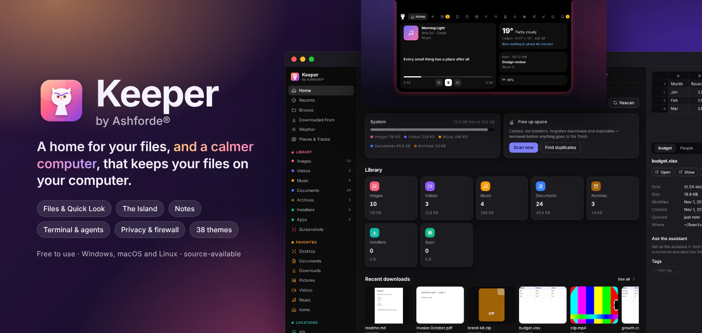
</p>

<h1 align="center">Keeper <sub><sup>by Ashforde®</sup></sub></h1>

<p align="center">
  <strong>A home for your files, and a calmer computer, that keeps your files on your computer.</strong><br>
  Files, search, the Island, notes, a terminal for people and AI agents, privacy tools and more, in one small app for <b>Windows, macOS and Linux</b>.
</p>

<p align="center">
  <a href="LICENSE.md"></a>
  <a href="https://github.com/ashfordeOU/keeper/actions/workflows/ci.yml"></a>
  
  
</p>

<p align="center">
  <a href="#install">Install</a> ·
  <a href="#feature-tour">Feature tour</a> ·
  <a href="#everything-is-a-switch">Everything is a switch</a> ·
  <a href="#privacy">Privacy</a> ·
  <a href="#cli-and-ai-agents">CLI and AI agents</a> ·
  <a href="#documentation">Docs</a> ·
  <a href="#licence">Licence</a>
</p>

---

## Why Keeper

- **Local first.** Indexing, search, text recognition, duplicates, cleanup, notes and transcription run on your computer. Your files are never uploaded. No account, no subscription, no ads.
- **Nothing is ever lost.** Your files only go to the Trash, every change is in History, and moves and renames can be undone.
- **One app instead of a drawer full.** A visual file library, a live Island at the top of the screen, a notes vault, a terminal, a firewall, a system monitor, remote access and an optional AI assistant, all sharing one engine.
- **Everything is a switch.** 121 features, each with its cost shown, each off completely when you turn it off: no window, no timer, no watcher.
- **Works with any AI, on your terms.** Keeper is an MCP server and a `keeper` command. Agents get exactly the permissions you give them (Off, Ask or Allow), and every change they make can be undone.
- **The same on every system.** Windows, macOS and Linux, plus the `keeper` command for terminals and servers. Where a system can't do something, Keeper says so.

---

## Feature tour

Every picture below is from Keeper itself, shown in light or dark to match your GitHub theme. They are made by [`scripts/screenshots.cjs`](scripts/screenshots.cjs): the real app on sample files, plus the browser demo's sample data for what needs accounts or other devices.

- [Files and search](#files-and-search) · [The Island](#the-island) · [Notes](#notes) · [Convert and PDF tools](#convert-and-pdf-tools)
- [Terminal and AI agents](#terminal-and-ai-agents) · [Computer use](#computer-use) · [Firewall, privacy and security](#firewall-privacy-and-security)
- [Places and Tracks](#places-and-tracks) · [Devices, Remote Desktops and Mesh](#devices-remote-desktops-and-mesh)
- [System monitor](#system-monitor) · [Keep Awake and Stage](#keep-awake-and-stage) · [System Settings+](#system-settings) · [Voice and meetings](#voice-and-meetings)
- [Cues](#cues) · [Wallpaper and Vibes](#wallpaper-and-vibes) · [Themes](#themes) · [And also](#and-also)

### Files and search

<picture>
  <source media="(prefers-color-scheme: dark)" srcset="docs/screenshots/home-dark.webp">
  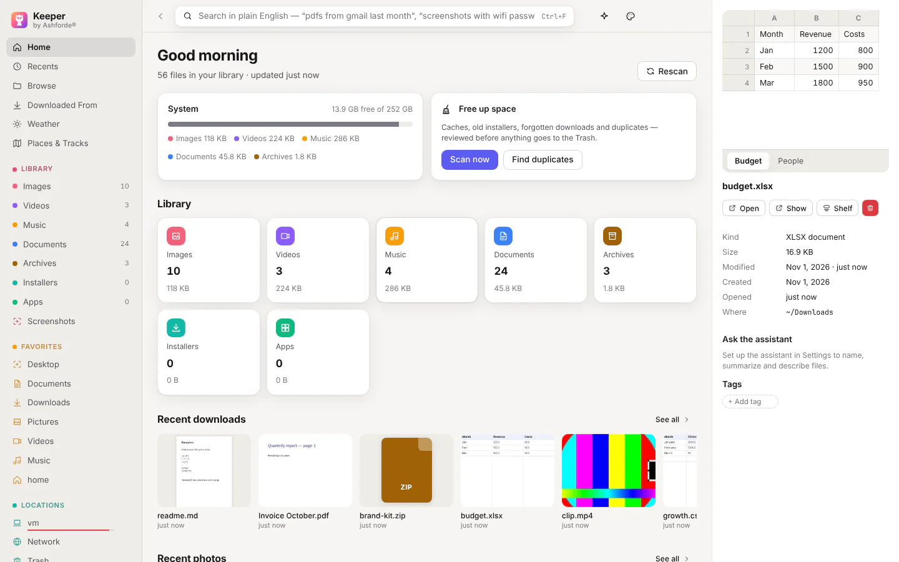
</picture>

- **Shelves** for images, videos, music, documents, archives, installers, apps and screenshots, with Recents, tags, saved searches and a sidebar of favourites, cloud drives, disks (with eject), network servers and the Trash.
- **Describe it, find it.** “screenshots with wifi password”, “pdfs from gmail last week over 5 MB”: Keeper turns your words into filters you can see and edit, and matches the text *inside* files and pictures (read on your computer).
- **Downloaded From** groups every download by the site or app it came from, using what your browser and system recorded.
- **Duplicates done properly**: byte-identical copies (SHA-256), look-alike photos and the same photo in two formats, with the copy to keep chosen and explained. The **Space Map** shows where your space went.
- **Clean Up** finds caches, old installers, unfinished downloads and old build folders, each labelled *Safe*, *Review* or *Permanent*. **Locked folders** encrypt a folder in place (AES-256-GCM) with a recovery key.

<p>
  <picture>
    <source media="(prefers-color-scheme: dark)" srcset="docs/screenshots/search-dark.webp">
    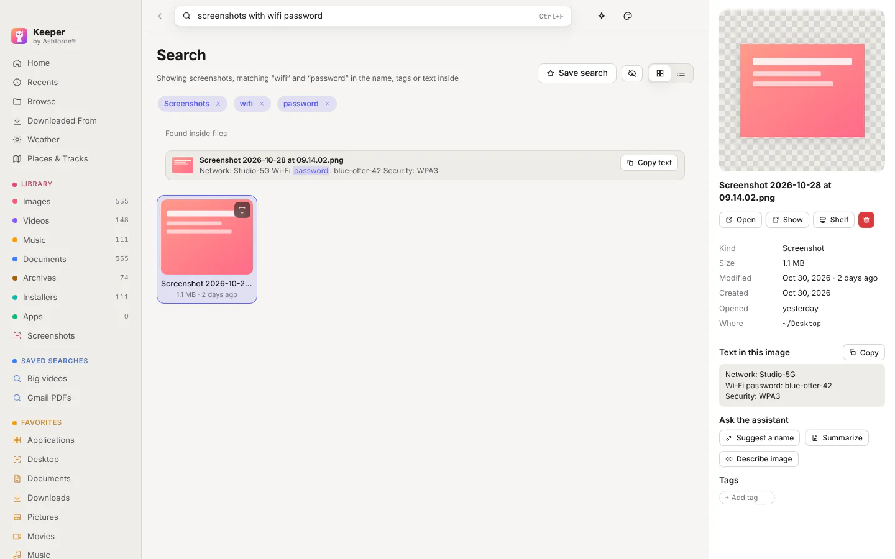
  </picture>
  <picture>
    <source media="(prefers-color-scheme: dark)" srcset="docs/screenshots/quicklook-dark.webp">
    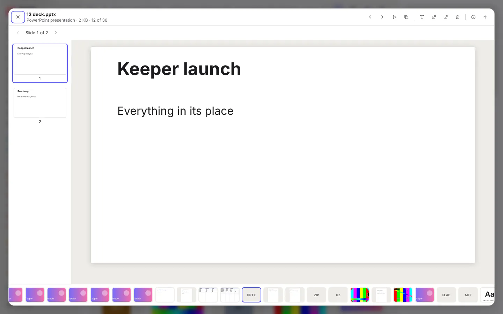
  </picture>
</p>
<p>
  <picture>
    <source media="(prefers-color-scheme: dark)" srcset="docs/screenshots/duplicates-dark.webp">
    
  </picture>
  <picture>
    <source media="(prefers-color-scheme: dark)" srcset="docs/screenshots/space-dark.webp">
    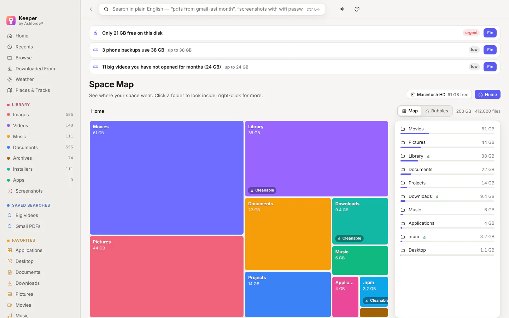
  </picture>
</p>

**Quick Look** (<kbd>Space</kbd>) previews almost anything without uploading it: photos (HEIC and camera RAW on every system), video and audio in any format, PDFs, Word, Excel and PowerPoint files, code in about 190 languages, archives without unpacking, e-books, fonts, 3D models and SQLite databases. Documents can never run code or load anything from the internet.

### The Island

<p align="center">
  <picture>
    <source media="(prefers-color-scheme: dark)" srcset="docs/screenshots/island-expanded-dark.webp">
    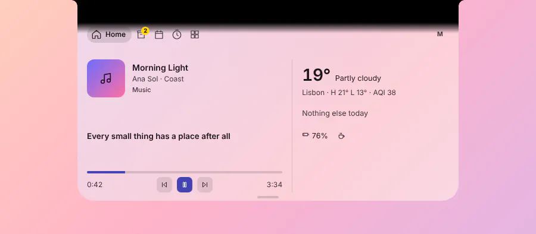
  </picture>
</p>
<p align="center">
  <picture>
    <source media="(prefers-color-scheme: dark)" srcset="docs/screenshots/island-pill-dark.webp">
    
  </picture>
  <picture>
    <source media="(prefers-color-scheme: dark)" srcset="docs/screenshots/island-notch-dark.webp">
    
  </picture>
</p>

- A live panel at the top of the screen, hidden until something happens: now playing with synced lyrics, timers, recordings, a meeting starting, a coding agent waiting, low battery and more, by importance.
- **Fits every screen**: it grows out of a Mac's notch, sits in or below the menu bar, under a GNOME top bar or flush with the top edge, follows the camera on tablets, and can live on every display.
- **More than twenty tools** in tabs: a drop shelf, clipboard history (passwords never kept), focus timer, Ask (any AI you connected), calendar, to-dos, notes, teleprompter, mirror, weather, unit and currency conversion, emoji and more.
- Every tool that reaches the internet is off until you turn it on. Linux on Wayland runs the Island through XWayland, because Wayland doesn't let apps keep a small window on top in a set place.

Details: [docs/ISLAND-TOOLS.md](docs/ISLAND-TOOLS.md) and [docs/ISLAND-CUES.md](docs/ISLAND-CUES.md).

### Notes

<picture>
  <source media="(prefers-color-scheme: dark)" srcset="docs/screenshots/notes-dark.webp">
  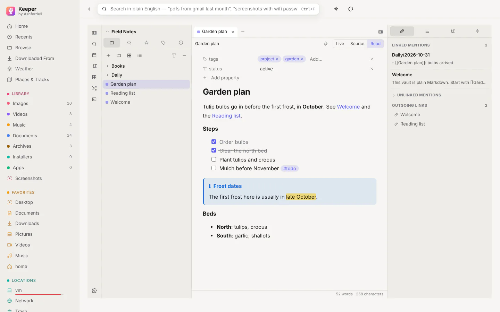
</picture>

- Open **any folder of Markdown files as a vault**. The files stay plain `.md` files, so a vault you already keep with another notes app opens as it is and keeps working there.
- `[[links]]` and embeds, properties, nested tags, callouts, math and diagrams; live preview, source and reading views; backlinks with unlinked mentions, a graph and search with operators.
- **Renames keep links working** across the vault. Daily notes from templates, canvases, bases, slides and publishing as a static site are built in.
- **Notes Everywhere** keeps one copy of all your notes, from every notes app you use, in a folder you own: search them together, see where each note lives, move notes between apps and keep dated backups ([docs/NOTES-EVERYWHERE.md](docs/NOTES-EVERYWHERE.md)).
- Nothing runs while the Notes page is closed; a 10,000-note vault is indexed in about a second. Details: [docs/NOTES.md](docs/NOTES.md).

### Convert and PDF tools

<picture>
  <source media="(prefers-color-scheme: dark)" srcset="docs/screenshots/convert-dark.webp">
  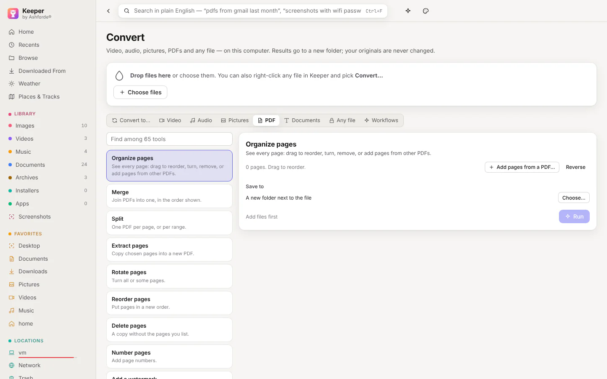
</picture>

- Video, audio, pictures, PDFs and documents converted **on this computer**; results go to a new folder and your originals are never changed.
- **PDF tools**: organize, merge, split, extract, rotate and number pages, watermarks, true redaction, fill and sign forms, searchable scans and passwords with print and copy limits.
- Transcribe audio with a built-in speech model, remove backgrounds, hide faces, scan to PDF, and translate documents and subtitles while keeping their layout.
- **Convert to…** from any file's right-click menu, workflows that chain steps, and `keeper tool <name> <files> --json` from the command line.

Details: [docs/FILEKIT.md](docs/FILEKIT.md) and [docs/TOOLS.md](docs/TOOLS.md), which checks each tool one by one.

### Terminal and AI agents

<picture>
  <source media="(prefers-color-scheme: dark)" srcset="docs/screenshots/terminal-dark.webp">
  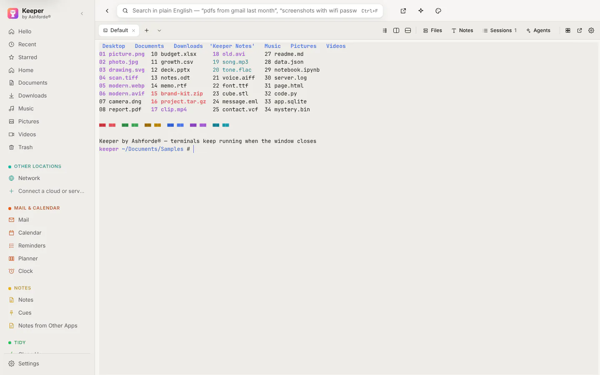
</picture>

- A full terminal on the Terminal page, in its own window or dropping down from the top of the screen, with tabs, split panes and saved workspaces.
- **Every shell on the computer**, including PowerShell, every WSL distribution and your SSH hosts. Terminals **keep running when the window closes**, and their scrollback survives a restart.
- **Profiles** with their own colours (12 schemes, or follow Keeper's theme, which gives each of the newer themes its own contrast-checked palette) and their own sign-ins, so two accounts of one tool work side by side.
- Shell integration marks every command with its exit code and time; triggers tell you in the Island when a program waits for an answer; SFTP and FTP panels sit beside the shell.
- **Agent terminals and the agent hub**: AI agents get the same terminals through MCP and `keeper term` / `keeper hub`, with clean bounded output, rooms, a shared task board, and you in charge: permission first, risky commands wait for a yes, **Stop all** at once.

<picture>
  <source media="(prefers-color-scheme: dark)" srcset="docs/screenshots/agents-dark.webp">
  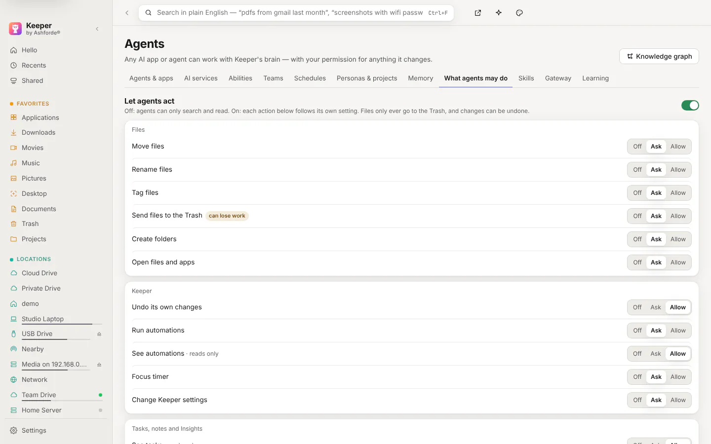
</picture>

Agents connected over MCP may move, rename, tag, open, run automations and more, each set to **Off, Ask or Allow**. Everything they do is in History under their name and can be undone. Details: [docs/TERMINAL.md](docs/TERMINAL.md), [docs/AGENTS.md](docs/AGENTS.md), [docs/ABILITIES.md](docs/ABILITIES.md) and [docs/TERMINAL-RESEARCH.md](docs/TERMINAL-RESEARCH.md).

### Computer use

<picture>
  <source media="(prefers-color-scheme: dark)" srcset="docs/screenshots/computer-use-dark.webp">
  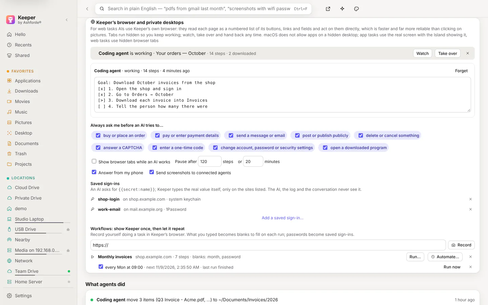
</picture>

- **Off until you turn it on.** An AI can see the screen, click, type and press buttons by name; the Island shows it while it works, and <kbd>Ctrl Alt Shift .</kbd> (<kbd>⌃⌥⌘.</kbd> on macOS) stops every AI at once.
- **Keeper's own browser** gives the AI numbered page elements instead of guesses; on Linux it can also work in a private desktop that leaves your screen alone.
- It **always asks** before buying, paying, sending, posting or deleting. Saved sign-ins are filled by Keeper, so the AI never sees them, and page text is treated as data, never as instructions.
- Record a job once and replay it with new values, on a schedule or when the computer wakes. Details: [docs/COMPUTER-USE.md](docs/COMPUTER-USE.md) and [docs/AI-SYSTEM.md](docs/AI-SYSTEM.md).

### Firewall, privacy and security

<p>
  <picture>
    <source media="(prefers-color-scheme: dark)" srcset="docs/screenshots/firewall-dark.webp">
    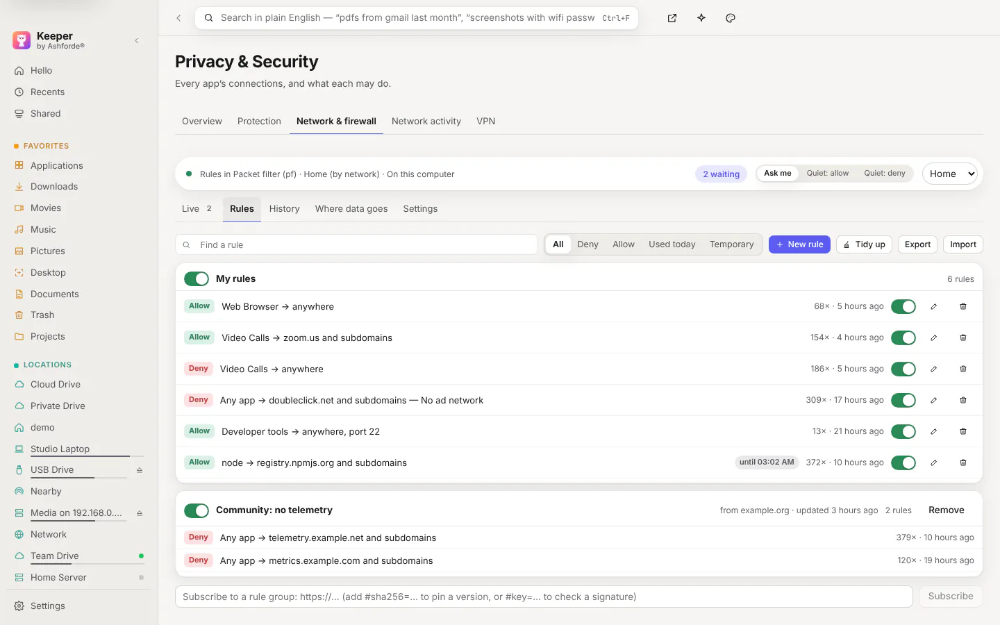
  </picture>
  <picture>
    <source media="(prefers-color-scheme: dark)" srcset="docs/screenshots/privacy-dark.webp">
    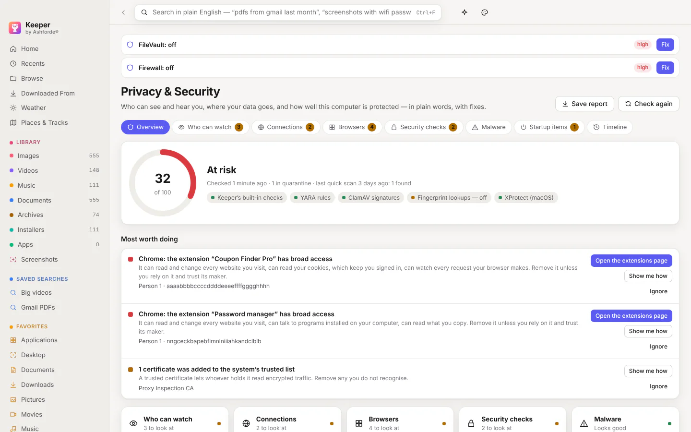
  </picture>
</p>

- **A per-app firewall, free**: rules by app and code signature, alerts for new connections (allow or deny, always or for now), profiles that follow your Wi-Fi, subscribed rule groups and a DNS filter with blocklists and encrypted DNS.
- What is enforced depends on the system, and the page says so: Windows Defender Firewall rules on **Windows**; nftables (and OpenSnitch for per-app rules) on **Linux**; the packet filter and DNS filter on **macOS**, where per-app blocking needs Apple's network-filter permission.
- **Privacy & Security** opens on a score and the three things most worth doing: who can use the camera, microphone and screen, which apps talk to trackers, browser extensions, system checks, and layered malware scanning with an encrypted quarantine.
- **Network Activity** shows which app talks to whom and whether it goes through the VPN; **Quick Controls** puts network, privacy and security switches in one place, each with Undo.
- No security tool detects everything, and Keeper doesn't either: it adds layers to your system's own protection. Details: [docs/FIREWALL.md](docs/FIREWALL.md), [docs/SECURITY-CENTER.md](docs/SECURITY-CENTER.md), [docs/NETWORK.md](docs/NETWORK.md) and [docs/QUICK-CONTROLS.md](docs/QUICK-CONTROLS.md).

### Places and Tracks

<picture>
  <source media="(prefers-color-scheme: dark)" srcset="docs/screenshots/tracks-dark.webp">
  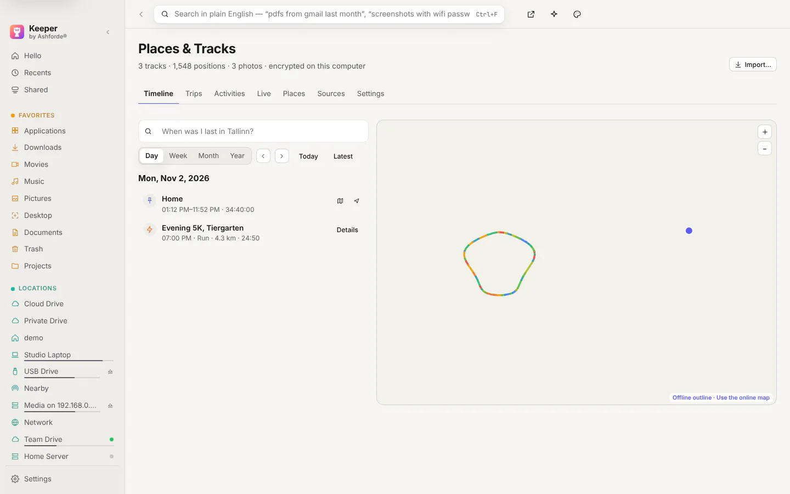
</picture>

- A **private, encrypted timeline** of where your things, people and activities have been, kept on this computer.
- Import GPX, KML/KMZ, GeoJSON, TCX and FIT files, a location-history export, a health export and photos with GPS; watch a folder for new watch files.
- Day, week, month and year views with stays and moves, trips that build themselves, activities with charts and records, and a map with online tiles or an offline outline.
- **Privacy zones** keep home and work out of exports, live receivers are off by default, and one switch deletes everything. Details: [docs/TRACKS.md](docs/TRACKS.md).

### Devices, Remote Desktops and Mesh

<p>
  <picture>
    <source media="(prefers-color-scheme: dark)" srcset="docs/screenshots/devices-dark.webp">
    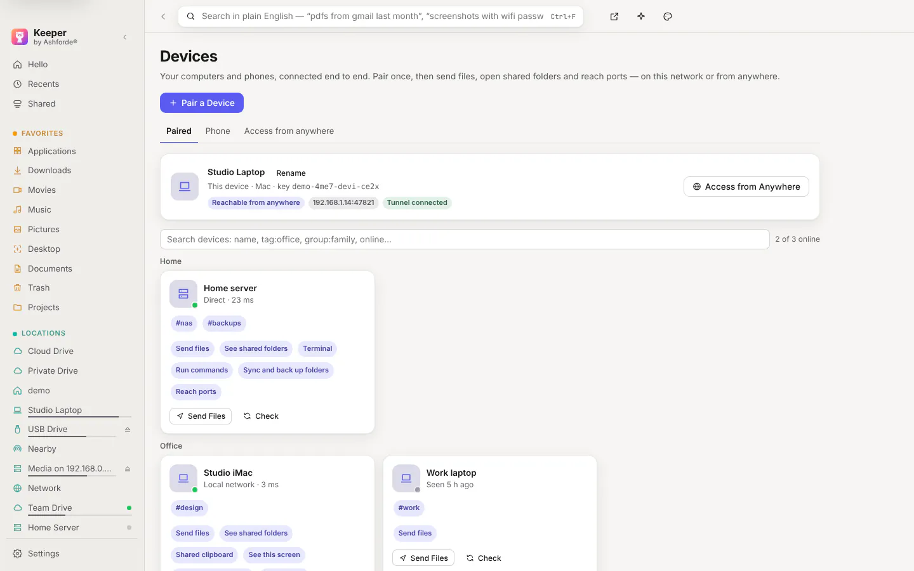
  </picture>
  <picture>
    <source media="(prefers-color-scheme: dark)" srcset="docs/screenshots/rdc-dark.webp">
    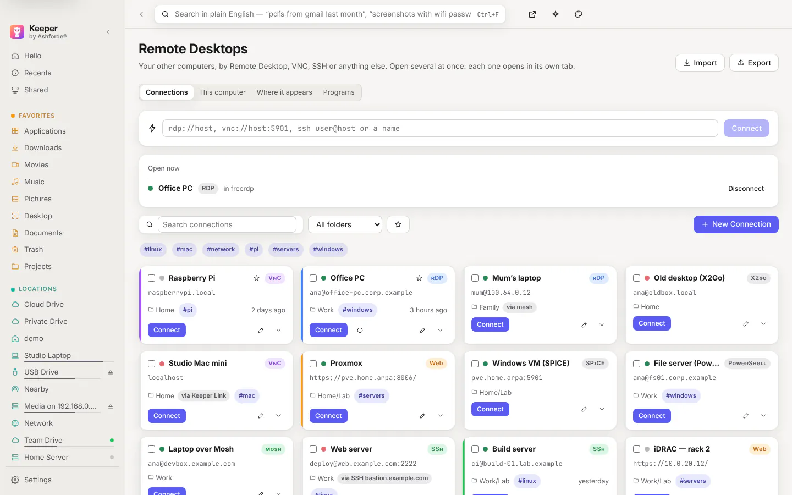
  </picture>
</p>
<p>
  <picture>
    <source media="(prefers-color-scheme: dark)" srcset="docs/screenshots/help-mode-dark.webp">
    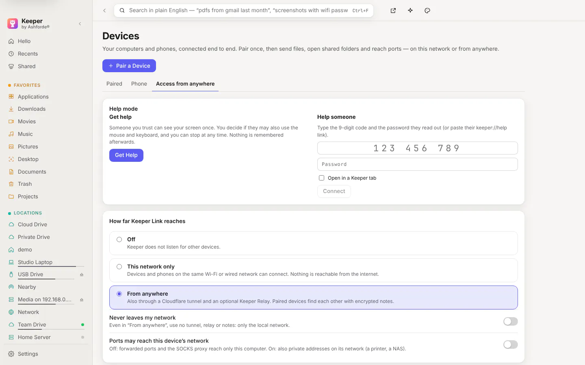
  </picture>
  <picture>
    <source media="(prefers-color-scheme: dark)" srcset="docs/screenshots/mesh-dark.webp">
    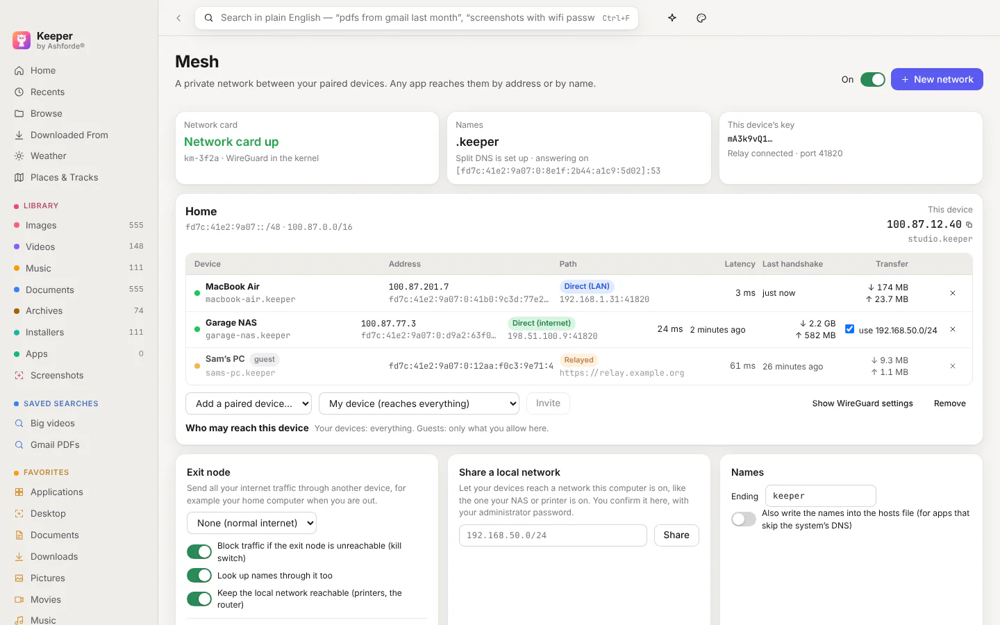
  </picture>
</p>

- **Keeper Link** pairs your computers and phones with a six-digit code, end to end encrypted, with no account and no company server in the middle. Send files, open shared folders, share the clipboard and reach ports, each permission per device.
- **Remote screens**: view or control another computer (the owner is asked each time, and a red banner shows while anyone watches). Control on Linux needs X11; on Wayland the screen can be watched but not controlled.
- **Remote Desktops**: VNC drawn by Keeper, SSH, Mosh, serial and web consoles in tabs, RDP, SPICE and X2Go through the system's client, reached directly, through a tunnel or through Keeper Link.
- **Help mode** (off until you switch it on): a one-time code and password let someone who isn't paired help you, and nothing is kept afterwards.
- **Keeper Mesh** (off by default): a private IP network built on WireGuard®, with names like `laptop.keeper`, hole punching, a blind relay fallback, exit nodes and shared subnets.

Details: [docs/LINK.md](docs/LINK.md), [docs/REMOTE.md](docs/REMOTE.md), [docs/REMOTE-DESKTOPS.md](docs/REMOTE-DESKTOPS.md) and [docs/MESH.md](docs/MESH.md). “WireGuard” is a registered trademark of Jason A. Donenfeld.

### System monitor

<picture>
  <source media="(prefers-color-scheme: dark)" srcset="docs/screenshots/monitor-dark.webp">
  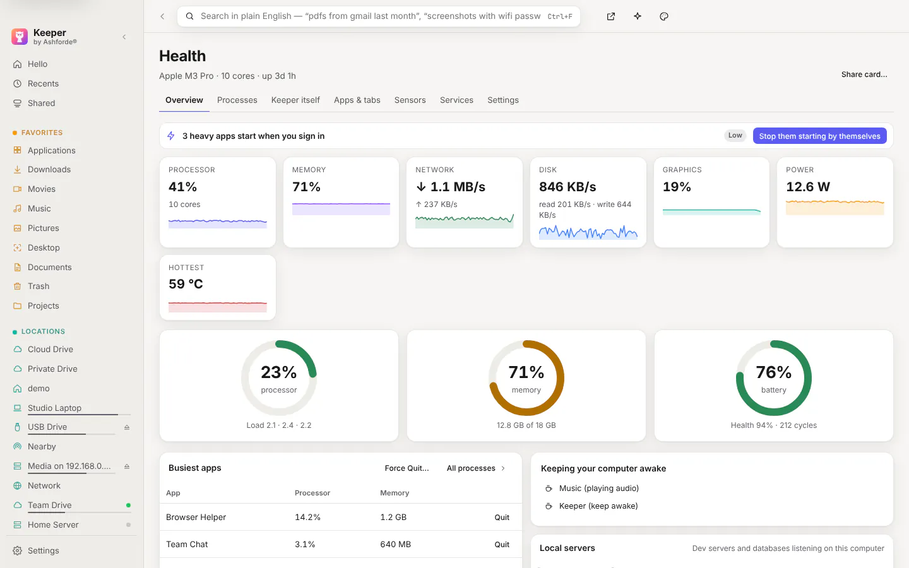
</picture>

<p>
  <picture>
    <source media="(prefers-color-scheme: dark)" srcset="docs/screenshots/monitor-history-dark.webp">
    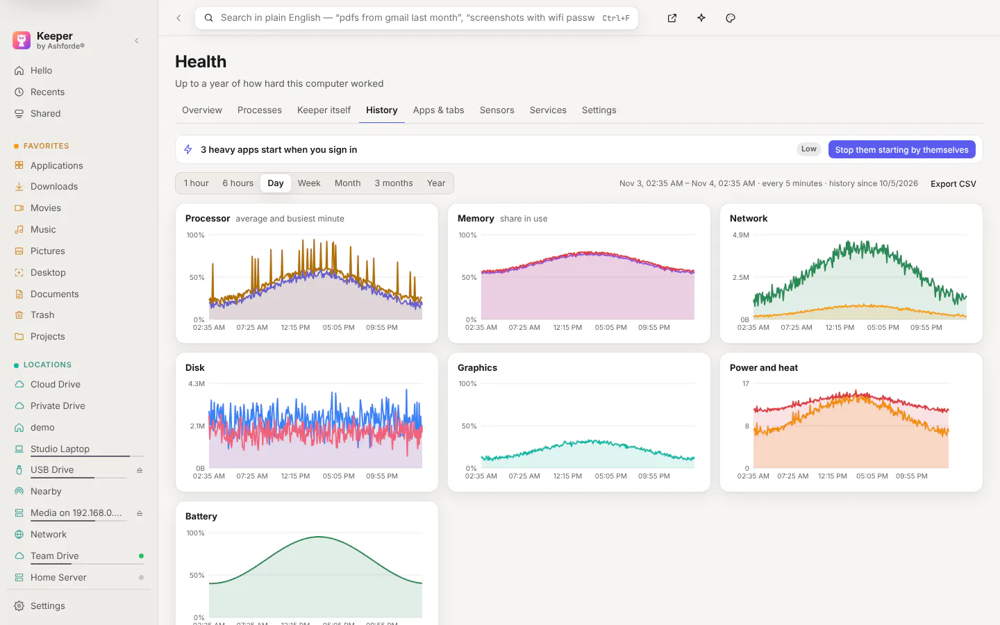
  </picture>
  <picture>
    <source media="(prefers-color-scheme: dark)" srcset="docs/screenshots/tray-dark.webp">
    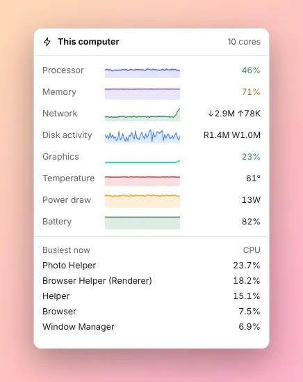
  </picture>
</p>

- **Live readings in the menu bar or tray** with a pop-over (off by default; it runs only while shown), and a year of history with zoomable charts and CSV export.
- A full **task manager**: processes as a list, tree or by app, with live graphs, Quit, Force Quit, Suspend, priorities and Inspect, plus system and user services.
- **Dev & agents**: dev servers by project with open, stop and restart, and running coding agents and model servers. **Sensors** read GPU, temperatures, fans and power draw through public interfaces only.
- Startup items, installed apps and what keeps the computer awake; `keeper ps`, `top`, `kill`, `ports`, `dev` and `sensors` on the command line. Details: [docs/MONITOR.md](docs/MONITOR.md).

### Keep Awake and Stage

<p>
  <picture>
    <source media="(prefers-color-scheme: dark)" srcset="docs/screenshots/awake-dark.webp">
    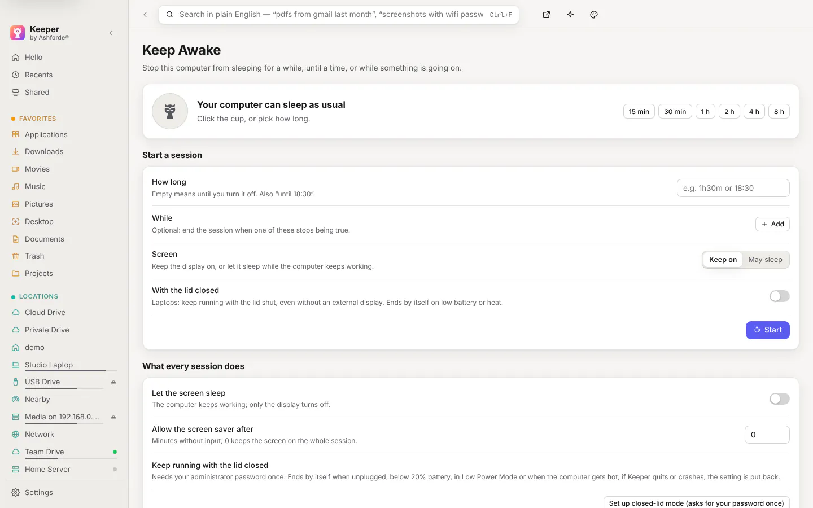
  </picture>
  <picture>
    <source media="(prefers-color-scheme: dark)" srcset="docs/screenshots/stage-dark.webp">
    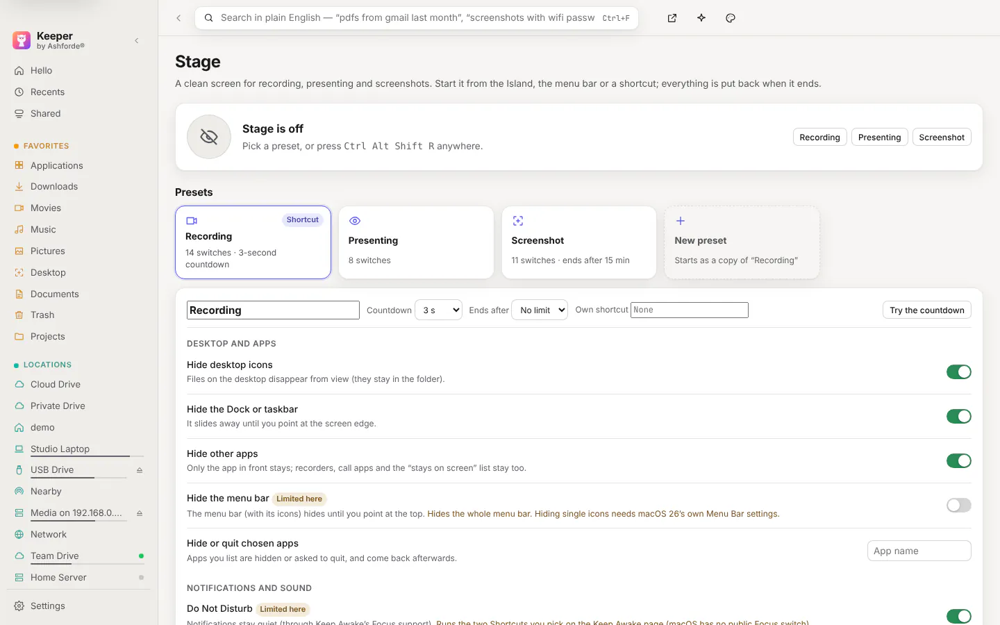
  </picture>
</p>

- **Keep Awake**: for a while, until a time, or **while** an app runs, a download finishes, a VPN is up or an AI agent works. Keep running with the lid closed, with a watchdog that puts the setting back. Costs nothing when idle.
- **Triggers** start sessions by themselves (Wi-Fi, apps, displays, calendar events, power), and `keeper awake on --for 2h` works from any terminal.
- **Stage** gives you a clean screen for recording, presenting and screenshots: hide desktop icons, the Dock or taskbar and other apps, Do Not Disturb, a pointer spotlight, click ripples and keystrokes.
- Every Stage change is journalled and put back when it ends, even after a crash. Some switches are X11-only on Linux; the per-system table says which.

Details: [docs/KEEP-AWAKE.md](docs/KEEP-AWAKE.md) and [docs/STAGE.md](docs/STAGE.md).

### System Settings+

<picture>
  <source media="(prefers-color-scheme: dark)" srcset="docs/screenshots/settingsplus-dark.webp">
  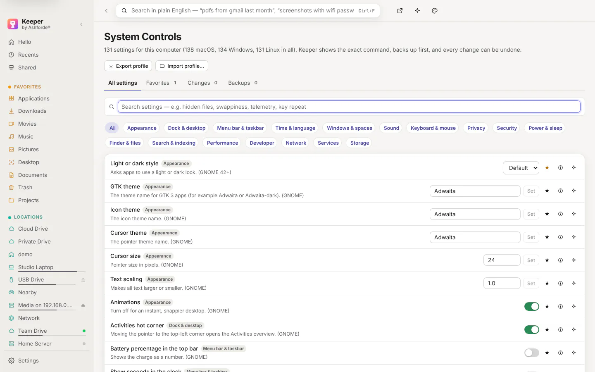
</picture>

- A searchable catalogue of **403 system settings** that usually need a terminal command or a buried switch: 138 on macOS, 134 on Windows and 131 on Linux.
- Each entry says what it does, which versions it applies to, whether it needs the administrator password, what has to restart and how risky it is.
- You see the exact command first; Keeper backs up the area before the first change each day, logs every change with **Undo**, and exports **setup profiles** to apply on another computer.
- **App controls** set network, CPU, memory, volume and more per app, and say what your system can't do. Full list: [docs/SETTINGS-CATALOG.md](docs/SETTINGS-CATALOG.md).

### Voice and meetings

<p>
  <picture>
    <source media="(prefers-color-scheme: dark)" srcset="docs/screenshots/dictation-dark.webp">
    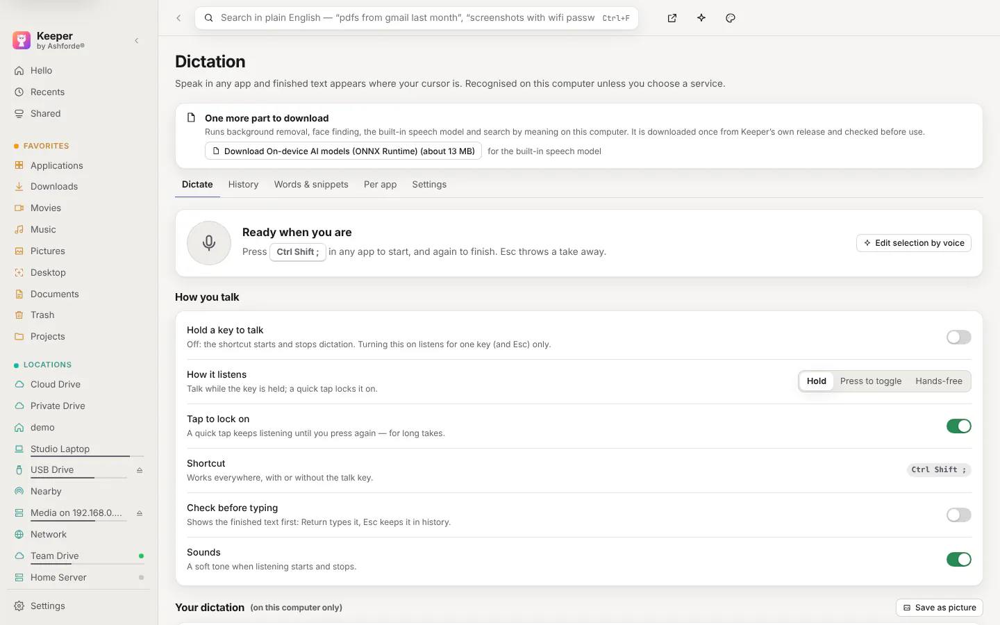
  </picture>
  <picture>
    <source media="(prefers-color-scheme: dark)" srcset="docs/screenshots/meetings-dark.webp">
    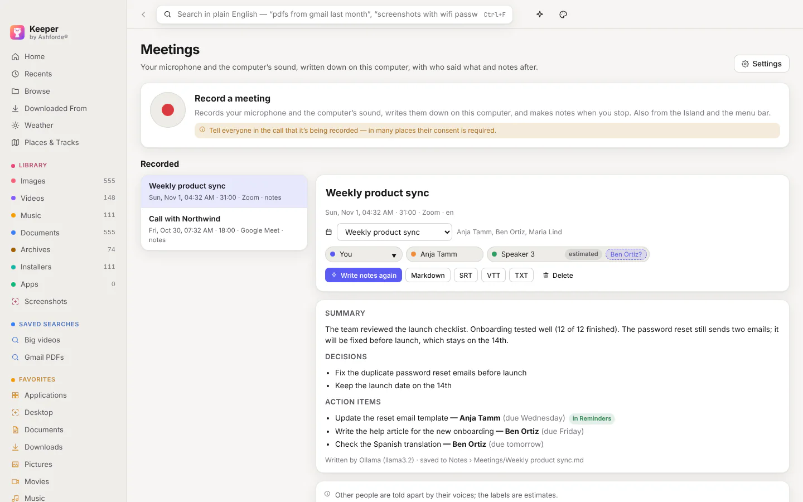
  </picture>
</p>

- **Dictation anywhere**: hold a key (or press the shortcut) in any app, speak, and finished text is typed at the cursor, recognised on this computer by default.
- Spoken commands, formatting, a personal dictionary, snippets and a tone per app. On Linux, typing uses `xdotool` on X11 and `wtype` on Wayland.
- **Meetings** records your microphone and the computer's sound, transcribes and tells speakers apart on this computer, and writes a summary with decisions and action items.
- Keeper reminds you to tell people in the call that it is recording. Details: [docs/VOICE.md](docs/VOICE.md).

### Cues

<picture>
  <source media="(prefers-color-scheme: dark)" srcset="docs/screenshots/cues-dark.webp">
  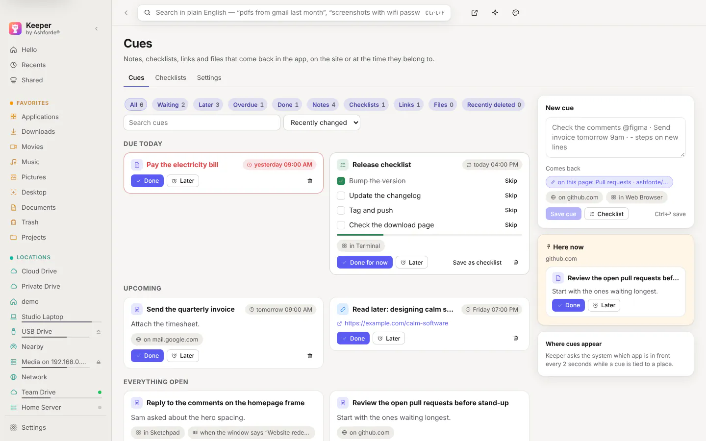
</picture>

- **Notes, checklists, links and files that come back** in the app, on the site or at the time they belong to.
- Each cue pops up beside the place it belongs to, without taking the keyboard; <kbd>Ctrl Alt K</kbd> (<kbd>⌘⌥K</kbd>) attaches a new one to whatever is in front.
- Due today, upcoming and everything open on one page; Done and Later from the Island; `keeper cues …` and `keeper://cue` links for scripts.
- **Island+** in the same release adds other apps' notifications, calls with mute, and volume and brightness levels beside the system's own pop-ups, each with honest per-system limits. Details: [docs/ISLAND-CUES.md](docs/ISLAND-CUES.md).

### Wallpaper and Vibes

<picture>
  <source media="(prefers-color-scheme: dark)" srcset="docs/screenshots/ambience-dark.webp">
  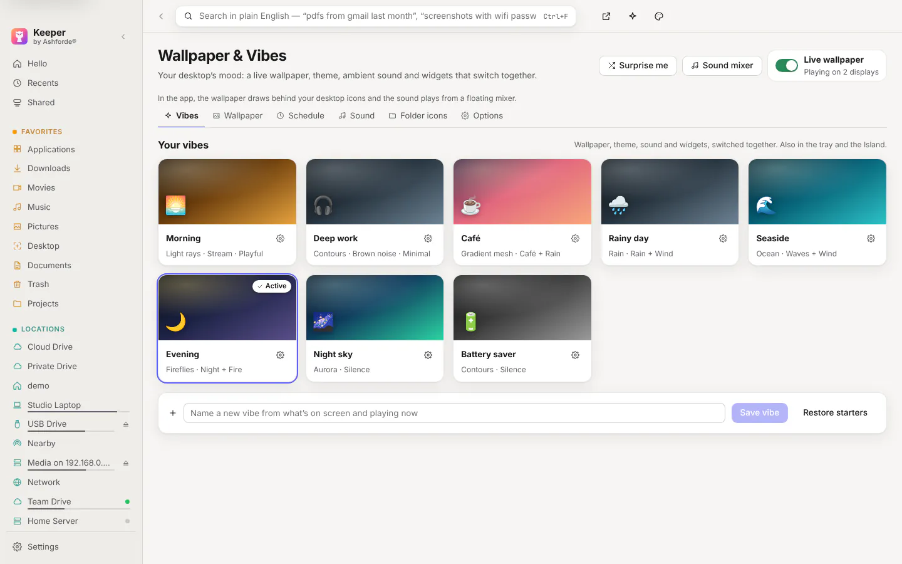
</picture>

- **Vibes** switch the wallpaper, theme, ambient sound and widgets together, by hand or on a schedule.
- A **live wallpaper** behind the desktop icons (off by default) that draws nothing when nobody can see it. Linux on Wayland has no desktop layer for apps, so Keeper sets a still frame there instead.
- **Ambient sound** made on the computer, with a ten-slider mixer and a sleep timer; desktop widgets and custom folder icons.
- From the tray, the Island, shortcuts, the command palette or `keeper ambience …`. Details: [docs/AMBIENCE.md](docs/AMBIENCE.md).

### Themes

<picture>
  <source media="(prefers-color-scheme: dark)" srcset="docs/screenshots/themes-dark.webp">
  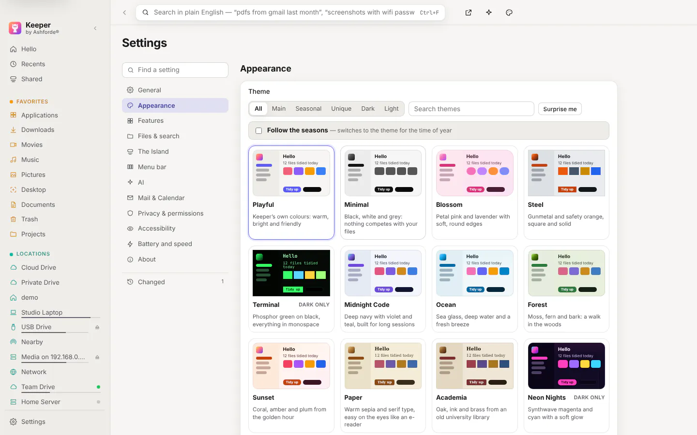
</picture>

- **38 themes**: 28 in the main collection, 5 seasonal and 5 unique showpieces, each a live preview in the gallery, with search and **Surprise me**.
- **Follow the seasons** switches to Frost, Spring Meadow, Summer Haze, Autumn Ember or Festive Lights on the right day, for your half of the world.
- Your own accent colour, font, density and corners on top of any theme. Every theme's text and buttons meet WCAG AA contrast, checked by the tests.
- Decorations never animate, so themes cost nothing while Keeper sits idle. Details: [docs/THEMES.md](docs/THEMES.md).

### And also

- **Mail, calendars, reminders and the clock**: any IMAP provider with new mail the moment it arrives, safe-to-read messages with trackers removed, CalDAV calendars with plain-English quick add, alarms and timers in the Island ([docs/PIM.md](docs/PIM.md)).
- **Sync and backup**: folders kept the same between your devices with no cloud in between, encrypted and deduplicated backups to a drive, a NAS or a cloud service, and cloud mirrors ([docs/SYNC.md](docs/SYNC.md)).
- **Cloud and servers**: about seventy cloud storage services through rclone, plus SFTP, FTP, WebDAV and SMB, browsed like the folders on your disk ([docs/CONNECT.md](docs/CONNECT.md)).
- **Keeper's brain**: the text inside your files read once, on your computer, so any AI you use finds things instantly; search by words and, when you turn it on, by meaning ([docs/BRAIN.md](docs/BRAIN.md)).
- **To do and guided fixes**: one list of what is worth doing about space, security, privacy and backups, each with a **Fix** that Keeper does or walks you through ([docs/GUIDE.md](docs/GUIDE.md)).
- **Monorail** (macOS 13 or later only): Keeper installs and works with Ashforde's free scrolling window manager ([docs/ASHFORDE-APPS.md](docs/ASHFORDE-APPS.md)). **Works with your computer**: Spotlight, Shortcuts and Apple Intelligence (macOS 26 on Apple silicon) on a Mac, File Explorer search and text recognition on Windows, GNOME search and KRunner on Linux ([docs/PLATFORM.md](docs/PLATFORM.md)).
- **Tabs and crash recovery**: tabs in every window, and every window, tab, scroll position and unsent draft saved within a second ([docs/RESILIENCE.md](docs/RESILIENCE.md)).

---

## Install

```bash
# macOS and Linux
curl -fsSL https://raw.githubusercontent.com/ashfordeOU/keeper/main/scripts/install.sh | sh
```

```powershell
# Windows (PowerShell)
irm https://raw.githubusercontent.com/ashfordeOU/keeper/main/scripts/install.ps1 | iex
```

The scripts check every download against the release checksums and add the `keeper` command. Homebrew, winget, Scoop, Chocolatey, the AUR, Flatpak, Snap, apt and dnf, npm (`keeper-cli`), updates, uninstalling and verifying downloads are all in **[docs/INSTALL.md](docs/INSTALL.md)**.

Or download the latest build from **[Releases](https://github.com/ashfordeOU/keeper/releases/latest)**. The file names never change, so these links always give you the newest version:

| System | Download | Notes |
|---|---|---|
| **macOS 12+**, Apple silicon | [Keeper-mac-arm64.dmg](https://github.com/ashfordeOU/keeper/releases/latest/download/Keeper-mac-arm64.dmg) | Open, drag Keeper into Applications |
| **macOS 12+**, Intel | [Keeper-mac-x64.dmg](https://github.com/ashfordeOU/keeper/releases/latest/download/Keeper-mac-x64.dmg) | |
| **Windows 10/11** (also Windows on ARM) | [Keeper-setup-x64.exe](https://github.com/ashfordeOU/keeper/releases/latest/download/Keeper-setup-x64.exe) | Per user, no administrator needed |
| Windows, no install | [Keeper-portable.exe](https://github.com/ashfordeOU/keeper/releases/latest/download/Keeper-portable.exe) | Runs from anywhere, e.g. a USB stick |
| **Linux** x64, any distribution | [Keeper-linux-x86_64.AppImage](https://github.com/ashfordeOU/keeper/releases/latest/download/Keeper-linux-x86_64.AppImage) | `chmod +x` and run |
| Linux ARM64 | [Keeper-linux-arm64.AppImage](https://github.com/ashfordeOU/keeper/releases/latest/download/Keeper-linux-arm64.AppImage) | |
| Debian, Ubuntu, Mint, Pop!_OS | `Keeper-linux-amd64.deb` / `-arm64.deb` | `sudo apt install ./Keeper-linux-amd64.deb` |
| Fedora, RHEL, openSUSE | `Keeper-linux-x86_64.rpm` / `-aarch64.rpm` | `sudo dnf install ./Keeper-linux-x86_64.rpm` |
| Other Linux | `Keeper-linux-x64.tar.gz` | Unpack anywhere and run `keeper` |

Every release lists `SHA256SUMS.txt`, a Sigstore signature of it and GitHub build attestations; see [Verifying a download](docs/INSTALL.md#verifying-a-download). Keeper keeps itself up to date (automatically, after asking, or only when you check, in **Settings → Updates**).

**First launch.** Builds are not yet signed with paid Apple and Microsoft certificates. On **Windows**, if SmartScreen appears, choose **More info → Run anyway**. On **macOS**, the install script removes the quarantine flag; after a dmg or Homebrew install choose **Open Anyway** in System Settings → Privacy & Security, or run `xattr -cr /Applications/Keeper.app`. On **Linux**, now playing, dictation and download sources use `playerctl`, `xdotool` (or `wtype` on Wayland) and `attr`.

---

## Everything is a switch

Keeper does a lot, and stays out of the way. **Settings → Features** lists every part of Keeper (121 features in [`core/features.ts`](core/features.ts)) with what it costs: what runs in the background, how often, and how much memory. Turning one off stops it completely: no window, no timers, no watchers, and its pages and menu items leave the sidebar. A test fails the build if any page, sidebar entry or command has no feature that owns it.

<picture>
  <source media="(prefers-color-scheme: dark)" srcset="docs/screenshots/features-dark.webp">
  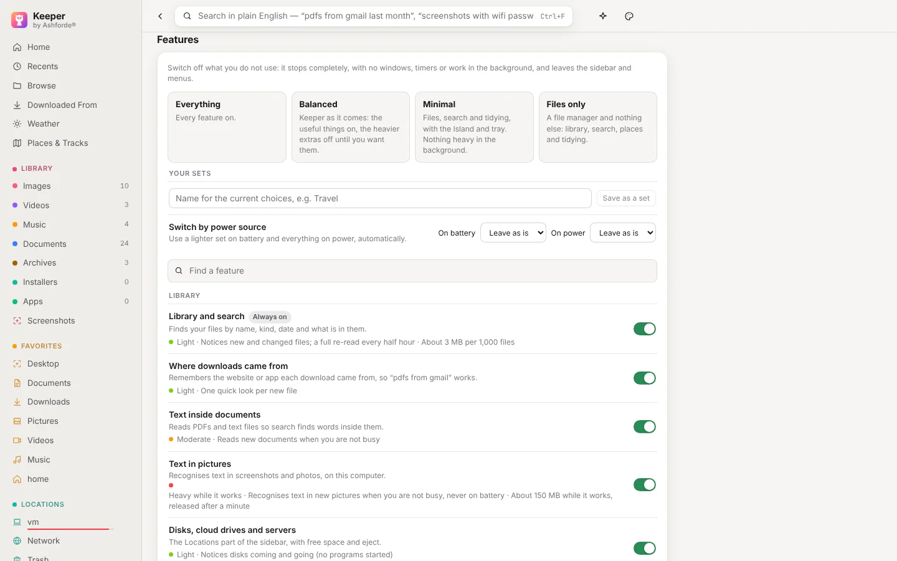
</picture>

- **Presets**: Everything, Balanced, Minimal and Files only, plus your own saved sets, and a set to switch to by itself **on battery** and another **on power**.
- **Resource modes** in **Settings → Keeper's own usage**: Minimal, Balanced (default) and Performance, with Keeper's processor and memory use right now and why background work is waiting.
- **The governor** slows background work while you work, waits while the computer is hot, short of memory or on battery, and catches up when you are away. Checks slow down after a minute without input and pause while the screen is locked.

Measured on Linux with a 14,400-file library (Xvfb, one minute per state, all of Keeper's processes together; memory is PSS):

| | Default features | Only the library on |
|---|---|---|
| First scan | 2.3 s, 2.3 s of processor | — |
| Idle, window open | 0.9 % of one core | 0.1 % |
| Idle, closed to the tray | 0.5 % | 0.3 % |
| Wake-ups per second (main process) | 25–35 | 3 |
| Memory | 340–490 MB | 270–310 MB |

A check in CI starts the built app and fails if Keeper idles above 1 % of a core or 550 MB.

---

## Privacy

- **Your files never leave your computer.** Indexing, search, text recognition, duplicate detection, cleanup, notes and transcription run locally.
- **No account, no ads.** Network requests happen only for features you turn on: weather (Open-Meteo), lyrics (LRCLIB), the calendars, mail and cloud services you connect, blocklists you pick, the update check (once a day, can be turned off), and the AI you chose, which gets only what you allow under *What AIs may see*, with passwords, keys and card numbers blanked first. *Only use AIs on this computer* keeps everything local.
- API keys and passwords are kept in the system keychain. On Linux without a keyring, Keeper refuses to store keys rather than store them weakly. Passwords you copy are never kept in clipboard history.

### Anonymous usage stats

Keeper sends anonymous usage stats **once a day** to help improve it. They are **on by default**, and here is exactly what that means:

- **What is sent**: a random install ID (resettable), Keeper's version, the operating system and its version, rough hardware facts (processor family, memory rounded to 4/8/16/32/64+ GB), the system's language and region, which features are on, rough page counts, crash and restart counts, and Keeper's own resource use as ranges.
- **Never sent**: file names, paths or contents, searches, AI prompts, account names, e-mail addresses, user or computer names, your internet address or location, serial numbers, Wi-Fi names, or which apps you have.
- **See it**: Settings → Privacy → *See exactly what's sent* shows the last report and the next one, field by field.
- **Turn it off** in any of four ways: the switch in **Settings → Privacy** (or in the welcome tour), `KEEPER_TELEMETRY=0`, `DO_NOT_TRACK=1`, or an administrator's policy file with `{ "usageStats": false }` (`/etc/keeper/policy.json`, `/Library/Application Support/Keeper/policy.json` or `%ProgramData%\Keeper\policy.json`). Once off, nothing more is sent.
- Reports are kept for 13 months. The full list, the legal basis and how to ask about your data: [docs/PRIVACY-USAGE-STATS.md](docs/PRIVACY-USAGE-STATS.md). The server is in [server/telemetry](server/telemetry).

### Safety model

Cleaning tools should never cost you a file:

1. **Your files go to the Trash; caches are deleted.** Anything you made or downloaded goes to the system Trash or Recycle Bin. Caches, logs and temporary files rebuild themselves, so they are deleted.
2. **Only known places.** What to clean comes from a known category, never from a path the interface sends, and paths are checked again right before anything is touched.
3. **System folders are off limits**: drive roots, your home folder itself, system folders, network paths, links and junctions, and anything in a folder you excluded.
4. **Files in use are skipped**, and so are cloud placeholders, so a scan never triggers downloads.
5. **Everything is reversible where possible**: startup items are switched off the way the system does it, rules are off until you enable them and can be previewed, and History lists every change.

---

## CLI and AI agents

The same engine runs in a terminal, handy for servers, scripts and Linux machines without a desktop. It is read-only unless you pass `--yes`.

```text
keeper search <words>      Plain-English search (--semantic: by meaning)
keeper scan / clean        What can be freed, and clearing rebuildable caches (preview unless --yes)
keeper dupes               Exact duplicates and HEIC/JPEG pairs
keeper ask <question>      Ask about your files with the AI chosen in Keeper (cites files; --plain for scripts)
keeper mcp                 Keeper as an MCP server for AI apps (stdio)
keeper acp                 Keeper as an agent for editors (Agent Client Protocol)
keeper term … / hub …      Terminals and the agent hub for AI agents
keeper link … / remote …   Devices, pairing, sending files, remote screens and SSH through Keeper Link
keeper awake / stage …     Keep Awake and Stage
keeper tool <name> <files> Any Convert tool (keeper tool list)
keeper ps / top / ports    The system monitor
```

**Keeper is an MCP server.** Any AI app that speaks the Model Context Protocol can search and read your library and Keeper's brain, with Keeper's safety rules: you decide whether AIs see names only, matching passages or whole files, secrets are blanked, and excluded folders are never read. **Connect** in Agents adds Keeper to popular AI apps and editors with one click (Keeper asks first and keeps a backup of their settings file), and a copyable entry works with any other MCP client:

```bash
keeper mcp    # stdio, for any MCP client
```

Also built in: an OpenAI- and Anthropic-compatible **model gateway** on 127.0.0.1 with a token (off by default), **agent-to-agent** (A2A), skills in the open `SKILL.md` format, and `keeper://` links for launchers and shortcuts (`keeper://search?q=…`, `keeper://ask?q=…`, `keeper://awake?minutes=60`). Details: [docs/AGENTS.md](docs/AGENTS.md), [docs/BRAIN.md](docs/BRAIN.md) and [docs/ABILITIES.md](docs/ABILITIES.md).

### Keyboard shortcuts

<kbd>Ctrl</kbd> on Windows and Linux is <kbd>⌘</kbd> on macOS. Global shortcuts can be changed in Settings.

| Find | | View | | Tidy and play | |
|---|---|---|---|---|---|
| Quick Search (any app) | <kbd>Ctrl Shift Space</kbd> | Grid / List | <kbd>Ctrl 1</kbd> / <kbd>Ctrl 2</kbd> | Duplicates | <kbd>Ctrl Shift D</kbd> |
| Search | <kbd>Ctrl F</kbd> | Inspector | <kbd>Ctrl I</kbd> | Clean Up | <kbd>Ctrl Shift K</kbd> |
| Command palette | <kbd>Ctrl K</kbd> | Quick Look | <kbd>Space</kbd> | Play / pause | <kbd>Ctrl Space</kbd> |
| Downloaded From | <kbd>Ctrl Shift J</kbd> | Switch theme | <kbd>Ctrl Shift L</kbd> | Move to Trash | <kbd>Ctrl ⌫</kbd> / <kbd>Delete</kbd> |
| Copy text in selected images | <kbd>Ctrl Shift C</kbd> | Hidden files | <kbd>Ctrl Shift .</kbd> | Dictation (any app) | <kbd>Ctrl Shift ;</kbd> |
| Copy text from screen (any app) | <kbd>Ctrl Shift 2</kbd> | New tab / reopen closed tab | <kbd>Ctrl T</kbd> / <kbd>Ctrl Shift T</kbd> | Settings | <kbd>Ctrl ,</kbd> |

---

## Platform support

| Feature | Windows | macOS | Linux |
|---|:---:|:---:|:---:|
| Library, search, text in images, duplicates, cleanup, Space Map, rules, history | ✅ | ✅ | ✅ |
| Download sources | ✅ | ✅ | ✅ (browsers that write `user.xdg.origin.url`) |
| Copy text from screen | ✅ | ✅ | ✅ (X11; Wayland through the portal) |
| The Island | ✅ | ✅ (around the notch) | ✅ (through XWayland on Wayland) |
| Remote control of this screen | ✅ | ✅ (Accessibility and Screen Recording) | X11 only; Wayland can be watched |
| Dictation typing | ✅ | ✅ | X11 `xdotool` / Wayland `wtype` |
| Now playing and lyrics | System media session | Music and other players | MPRIS (`playerctl`) |
| Microphone in use | ✅ | system lights | ✅ |
| System text recognition | Windows.Media.Ocr | Live Text (Vision) | built-in reader |
| On-device AI model | — (Store apps only) | Apple Intelligence (macOS 26) | local model via Ollama |
| Desktop search | File Explorer “Search with Keeper” | Spotlight | GNOME search, KRunner |
| Firewall enforcement | Defender Firewall per program | packet filter and DNS filter | nftables, OpenSnitch per app |
| Live wallpaper | ✅ | ✅ | X11; a still frame on Wayland |
| Monorail | — | ✅ (macOS 13+) | — |
| AI agents (MCP) | ✅ + agent registry | ✅ | ✅ |

## Build from source

Requires **Node.js 22+**.

```bash
npm install          # dependencies and the Electron binary
npm run dev          # the app with hot reload
npm run demo         # the interface alone in a browser at http://localhost:5180, with sample data (your disk is not touched)
npm test             # unit tests
npm run typecheck
npm run build        # interface + main process + CLI into dist/, dist-electron/, dist-cli/
npm run dist:linux   # installers (also :win and :mac on those systems)
```

Fresh screenshots for this page: build, then `xvfb-run -a -s "-screen 0 1920x1200x24" node scripts/screenshots.cjs` (see the top of the script for options). The project layout is in [docs/ARCHITECTURE.md](docs/ARCHITECTURE.md).

---

## Documentation

| Area | Documents |
|---|---|
| Getting started | [Install](docs/INSTALL.md) · [Guided fixes and the To do list](docs/GUIDE.md) · [Themes](docs/THEMES.md) · [Tools, checked one by one](docs/TOOLS.md) |
| Files | [File kit: PDF tools and Convert](docs/FILEKIT.md) · [Cloud and servers](docs/CONNECT.md) · [Sync and backup](docs/SYNC.md) · [Keeper's brain](docs/BRAIN.md) |
| Notes and mail | [Notes](docs/NOTES.md) · [Notes Everywhere](docs/NOTES-EVERYWHERE.md) · [Mail, calendars, reminders and the clock](docs/PIM.md) |
| Island and desktop | [Island tools](docs/ISLAND-TOOLS.md) · [Island+ and Cues](docs/ISLAND-CUES.md) · [Wallpaper and Vibes](docs/AMBIENCE.md) · [Stage](docs/STAGE.md) · [Keep Awake](docs/KEEP-AWAKE.md) · [Voice](docs/VOICE.md) |
| AI and agents | [AI agents](docs/AGENTS.md) · [Abilities for every AI](docs/ABILITIES.md) · [Computer use](docs/COMPUTER-USE.md) · [The system's assistants](docs/AI-SYSTEM.md) · [Terminal](docs/TERMINAL.md) · [Terminal research](docs/TERMINAL-RESEARCH.md) |
| Devices | [Keeper Link](docs/LINK.md) · [Remote screens and phones](docs/REMOTE.md) · [Remote Desktops](docs/REMOTE-DESKTOPS.md) · [Keeper Mesh](docs/MESH.md) · [Places and Tracks](docs/TRACKS.md) · [Devices roadmap](docs/ROADMAP-DEVICES.md) |
| Security and system | [Privacy and Security](docs/SECURITY-CENTER.md) · [Firewall](docs/FIREWALL.md) · [Network Activity and VPN](docs/NETWORK.md) · [Quick Controls](docs/QUICK-CONTROLS.md) · [System monitor](docs/MONITOR.md) · [System Settings+](docs/SETTINGS-CATALOG.md) |
| Inside Keeper | [Architecture](docs/ARCHITECTURE.md) · [Keeper inside your operating system](docs/PLATFORM.md) · [Staying up and coming back](docs/RESILIENCE.md) · [Ashforde apps](docs/ASHFORDE-APPS.md) · [Anonymous usage stats](docs/PRIVACY-USAGE-STATS.md) |
| Project | [Changelog](CHANGELOG.md) · [Contributing](CONTRIBUTING.md) · [Security policy](SECURITY.md) |

## Contributing

Contributions of every size are welcome. Please read [CONTRIBUTING.md](CONTRIBUTING.md): keep the core free of Electron, add tests for engine changes, follow the safety model, and keep the interface copy plain and friendly. Before your first pull request, read the [contributor terms](CONTRIBUTING.md#contributor-terms): you keep the copyright in your work and give Ashforde OÜ a licence to use it, including in commercial versions of Keeper. Security issues: see [SECURITY.md](SECURITY.md).

## Licence

Keeper is **free to use**, for everyone, at home and at work. Its source code is public so you can read it, check what it does with your files, build it yourself and change it for your own use.

Keeper is **source-available**, not open source. It is licensed under the [PolyForm Shield License 1.0.0](LICENSE.md):

- ✅ Use Keeper for any purpose, personal or professional, in any organisation.
- ✅ Read, build and change the code for yourself or your organisation; fork it on GitHub to send changes.
- ✅ Build tools, scripts and integrations that work with Keeper.
- ❌ Don't sell, resell, rent or offer Keeper (or a modified Keeper) as a product or service that competes with it, paid or free, without written permission from Ashforde OÜ.

“Keeper by Ashforde®”, “Ashforde®” and the Keeper logo are trademarks of Ashforde OÜ. The licence grants no trademark rights: modified builds must use a different name and logo. See [TRADEMARKS.md](TRADEMARKS.md). Need something the licence doesn't allow, or a commercial licence? See [COMMERCIAL.md](COMMERCIAL.md) or write to **contact@ashforde.org**.

Keeper includes third-party components under their own licences, listed in [THIRD-PARTY-NOTICES.md](THIRD-PARTY-NOTICES.md), among them Electron, React, Tesseract.js, sharp with libvips, libheif and FFmpeg (GPL-3.0-or-later, shipped as a separate program). Forecasts by [Open-Meteo](https://open-meteo.com) (CC BY 4.0), lyrics by [LRCLIB](https://lrclib.net), [IP Geolocation by DB-IP](https://db-ip.com) (CC BY 4.0) and world outlines from [Natural Earth](https://www.naturalearthdata.com) (public domain).

---

<p align="center">
  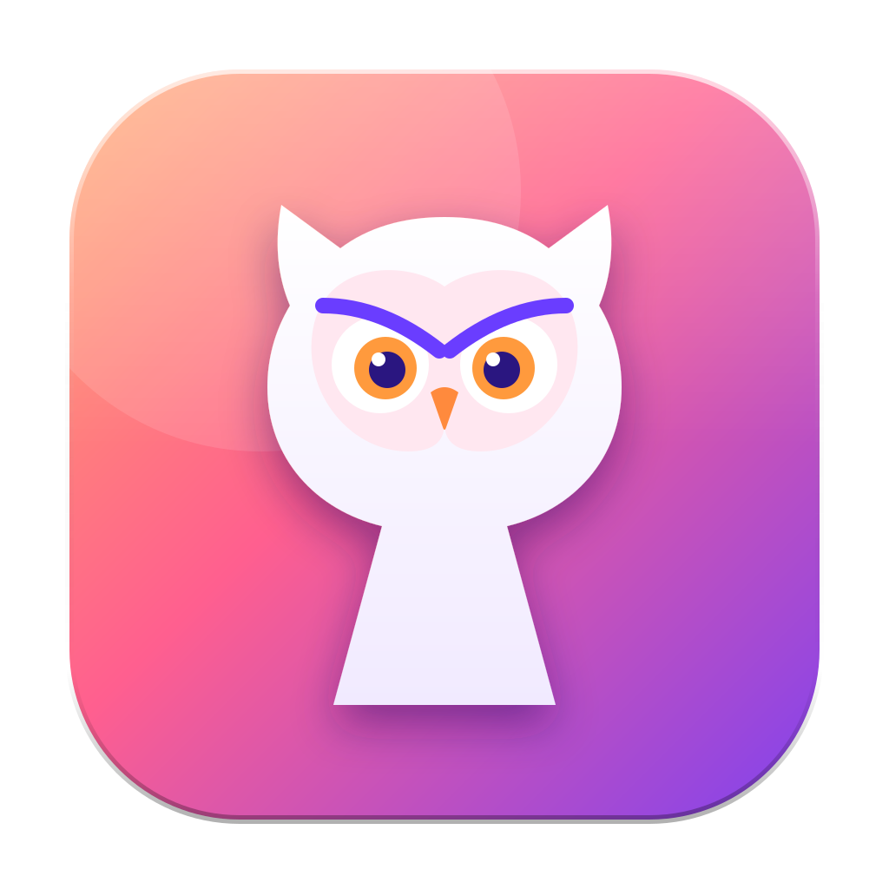<br>
  <sub><b>Keeper by Ashforde®</b> · © 2026 Ashforde OÜ · Ashforde® is a registered trademark of Ashforde OÜ.<br>Source-available under the PolyForm Shield License 1.0.0; free to use.</sub>
</p>
