<p align="center">
  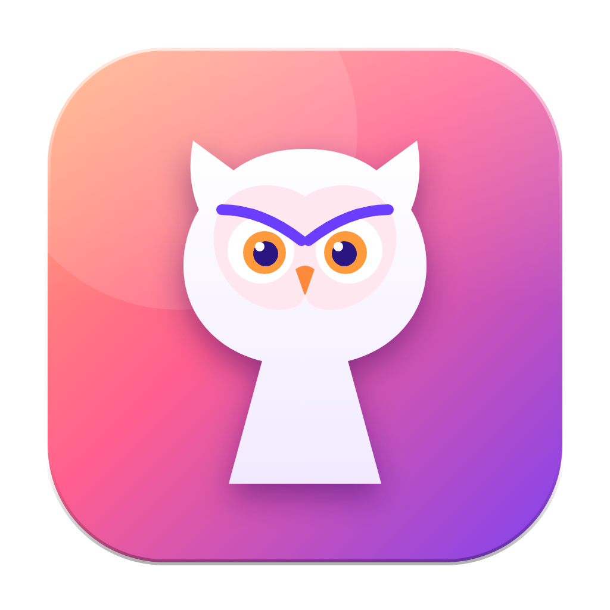
</p>

<h1 align="center">Keeper <sub><sup>by Ashforde®</sup></sub></h1>

<p align="center">
  <strong>A home for your files.</strong><br>
  Browse everything as big, clear thumbnails. Find any file by describing it. Read the text inside screenshots.<br>
  See where downloads came from. Clear duplicates and clutter safely. Keep a live Island at the top of your screen.<br>
  Free, open source, private — on <b>Windows, macOS and Linux</b>.
</p>

<p align="center">
  <a href="LICENSE"></a>
  
  
  <a href="https://github.com/ashfordeOU/keeper/actions/workflows/ci.yml"></a>
</p>

<p align="center">
  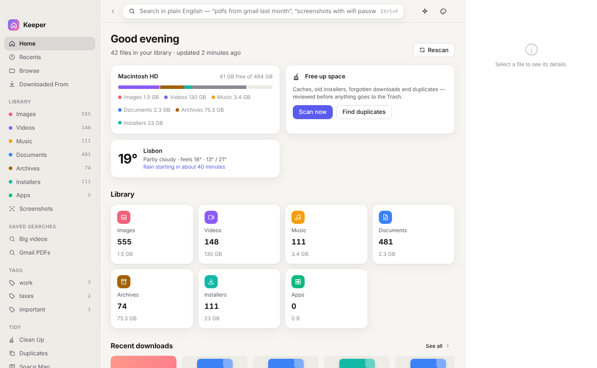
</p>

Keeper brings together a visual file library, plain-English search, a safe disk cleaner, a duplicate finder,
a live Island panel, a clipboard history, a screen-text grabber, a keep-awake switch, a developer toolbox and an
optional AI assistant — in one small app that never uploads your files.

- **No account. No subscription. No ads. No tracking.** Everything runs on your computer.
- **Nothing is ever lost.** Your files only go to the Trash, every change is in History, and moves and renames can be undone.
- **Works where you work.** One app for Windows, macOS and Linux, plus a `keeper` command for terminals and servers.

---

## Contents

- [Highlights](#highlights)
- [Everything Keeper does](#everything-keeper-does)
  - [Library and browsing](#library-and-browsing) · [Previews for every file](#previews-for-every-file) · [Plain-English search](#plain-english-search) · [Text in images](#text-in-images-and-on-screen) · [Downloaded From](#downloaded-from)
  - [Duplicates](#duplicates) · [Clean Up](#clean-up) · [Space Map](#space-map) · [Automations](#automations) · [History and undo](#history-and-undo)
  - [The Island](#the-island) · [Locked folders](#locked-folders) · [Themes](#themes) · [Quick Search, tray and deep links](#quick-search-tray-and-deep-links) · [Toolbox](#toolbox) · [System](#system) · [Assistant](#assistant)
  - [Command line](#command-line)
- [Keyboard shortcuts](#keyboard-shortcuts)
- [Keeper compared with your system file manager](#keeper-compared-with-your-system-file-manager)
- [Privacy](#privacy) · [Safety model](#safety-model)
- [Install](#install) · [Build from source](#build-from-source) · [Project layout](#project-layout)
- [Platform support](#platform-support) · [Roadmap](#roadmap) · [Contributing](#contributing) · [License](#license)

---

## Highlights

| | |
|---|---|
| 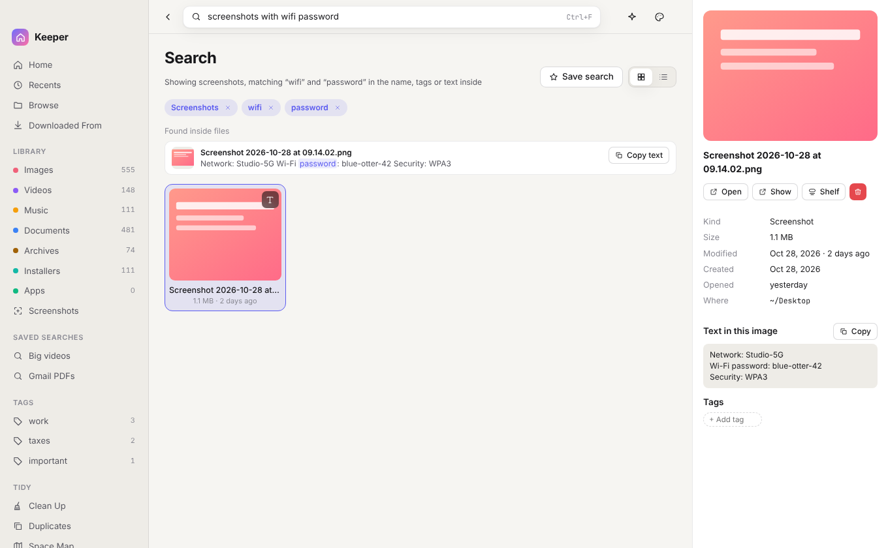 | **Describe it, find it.** “screenshots with wifi password”, “pdfs from gmail last week over 5 MB”, “videos from my iphone in august”. Keeper turns your words into filters you can see and edit, and matches the text *inside* files and images. |
| 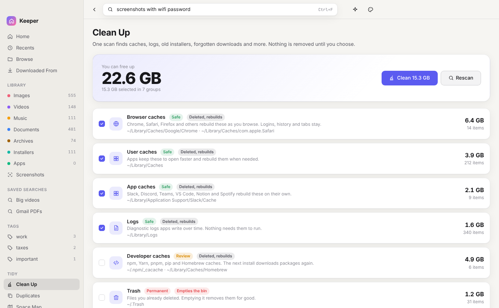 | **Free up space without fear.** One scan finds browser and app caches, logs, old installers, unpacked archives, unfinished downloads, forgotten downloads, old screenshots, big old videos, old project build folders, AI model caches and unused apps — each labelled *Safe*, *Review* or *Permanent*. |
| 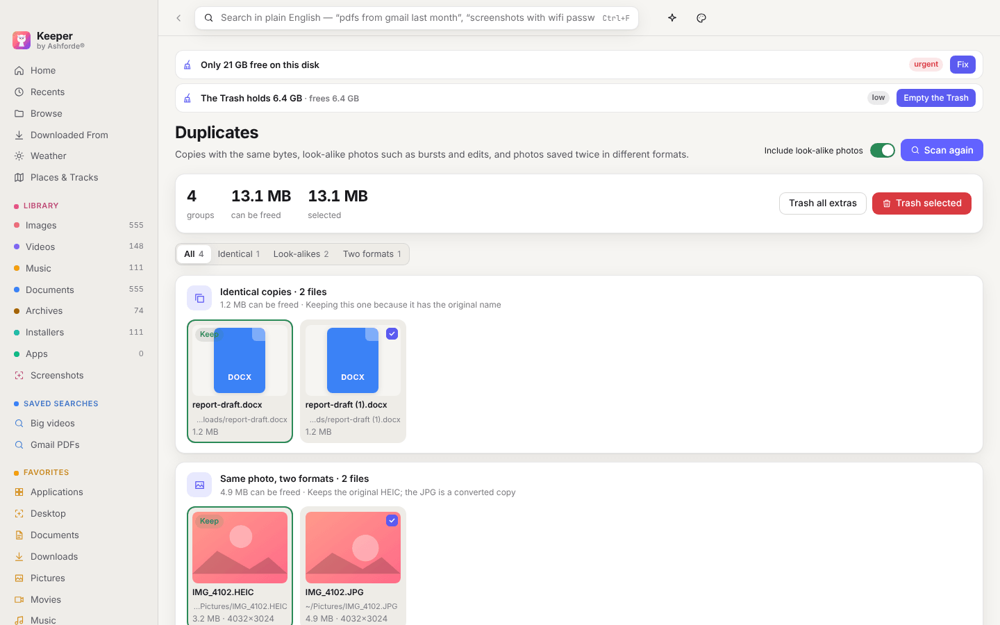 | **Duplicates, done properly.** Byte-identical copies (SHA-256), look-alike photos (bursts, edits, resized copies) and the same photo saved twice (HEIC + JPEG, RAW + JPEG). Keeper picks the copy to keep and tells you why. |
| 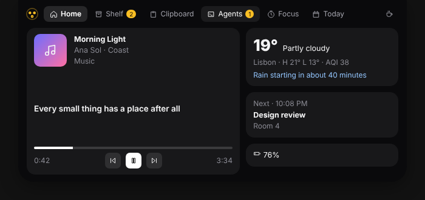 | **The Island.** A live panel at the top of the screen: now playing with synced lyrics, a drag-and-drop shelf, clipboard history, focus timer, keep-awake, weather, your next meeting, coding-agent status and dictation. |
| 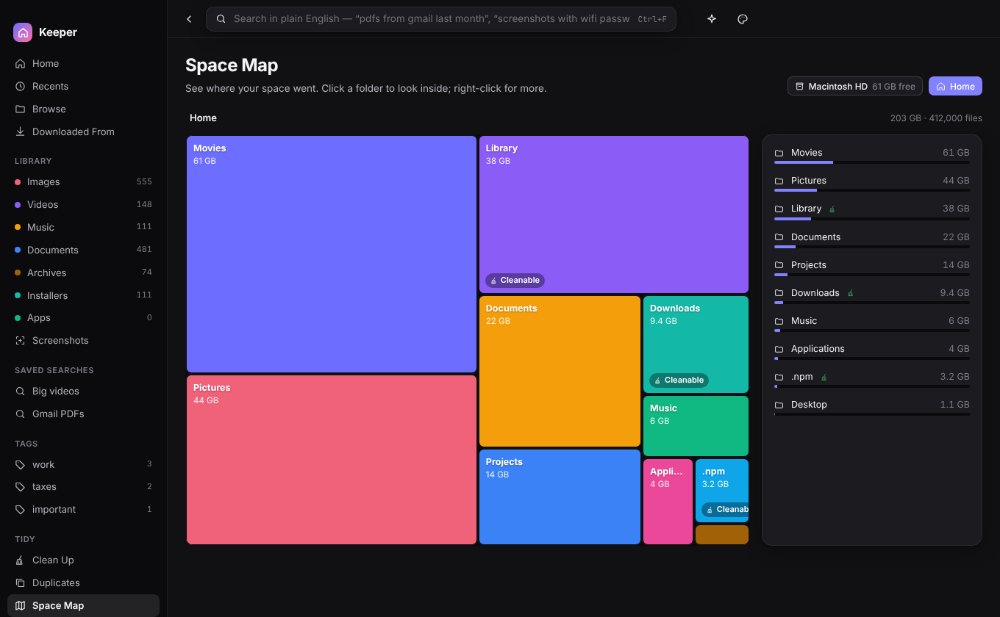 | **See where your space went.** The Space Map draws every folder at its true size, marks folders Keeper can clean, and lets you drill in. |
| 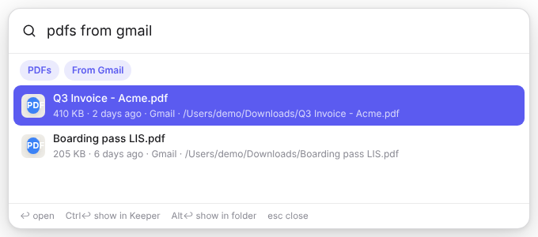 | **Search from anywhere.** <kbd>Ctrl/⌘</kbd><kbd>Shift</kbd><kbd>Space</kbd> opens Quick Search over any app, with the same plain-English understanding. |

---

## Everything Keeper does

### Library and browsing

- **Shelves** for Images, Videos, Music, Documents, Archives, Installers, Apps and Screenshots, plus Recents, Tags, Saved searches and pinned folders in the sidebar.
- **Home dashboard** with disk usage by kind, totals per shelf, recent photos, videos, music and documents, recent downloads with their source, the weather and a one-click cleanup.
- **Browse** any folder with breadcrumbs, grid or list view, new folders and “pin to sidebar”.
- **Hidden files** on or off with one button in the toolbar (an eye), <kbd>Ctrl/⌘ Shift .</kbd> or the command palette. Hidden items show dimmed. Keeper counts a file as hidden when its name starts with a dot, when Windows marks it hidden, when macOS sets its hidden flag, or when a Linux folder's `.hidden` file lists it.
- **Locked folders**: right-click a folder → *Lock Folder…*. See [Locked folders](#locked-folders).
- **Places in the sidebar**, like a file manager's: *Favorites* (Applications, Desktop, Documents, Downloads, Pictures, Movies/Videos, Music, your home folder and any folder you drag in) and *Locations* (Shared, iCloud Drive, OneDrive, Google Drive, Dropbox, Proton Drive, Box, pCloud, MEGA, Nextcloud and other cloud drives; this computer; every internal, USB, SD-card, disc and disk-image volume with its free space and an eject button; AirDrop on a Mac; connected network shares; Network; Trash). Right-click any place for Open, Show in folder, Get Info (total size) or Remove from Sidebar.
- **Network and Connect to Server**: servers on the local network announce themselves (NAS boxes, Macs with file sharing, Samba with Avahi, Windows computers), and any `smb://`, `afp://`, `nfs://`, `sftp://`, `ftp://`, `webdav(s)://` address or `\\server\share` path connects and opens — typed in Connect to Server or straight into the Browse path bar (double-click the breadcrumbs). Recent servers are remembered; passwords never are.
- **Trash / Recycle Bin**: every deleted item with where it came from and when, *Put Back*, *Delete Immediately* and *Empty Trash* — including the per-disk trash folders on USB drives.
- **Share…** from the right-click menu: the system share sheet with AirDrop, Mail and Messages on macOS, KDE Connect devices or an email attachment on Linux, an email on Windows.
- **Cloud and network folders stay out of the library walk** by default, so a NAS or an on-demand cloud drive is never crawled or downloaded (Settings → *Include network drives and cloud folders in the library*). Files kept only in the cloud are marked in Browse.
- **Grid or list** (<kbd>Ctrl/⌘ 1</kbd> / <kbd>Ctrl/⌘ 2</kbd>), adjustable card size (<kbd>Ctrl/⌘ +</kbd> / <kbd>−</kbd>), sort by name, date, size or kind, arrow-key navigation, <kbd>Shift</kbd>/<kbd>Ctrl/⌘</kbd> multi-select, select all.
- **Inspector** (<kbd>Ctrl/⌘ I</kbd>): large preview, dimensions, duration, camera, created/modified/opened dates, location, download source with the original link, text found in the image, and tags.
- **Right-click menu**: Open, Open With, Quick Look, Show in folder, Copy, Copy Path, Copy Text in Image, Add to Shelf, Pin to Sidebar, Rename, Compress to ZIP, Move to Trash.
- **Batch rename** with a live preview and conflict check: find & replace (plain or regex), name templates with counters and dates (`Trip {n:3}`, `{date} {name}`), add prefix/suffix, change case, clean up “ (1)” and “copy” leftovers. Undoable.
- **Tags** on any file, searchable with `#tag`.
- **Drag files out** into any app — one or many at a time.
- **Built-in music player**: double-click a song to play it in the toolbar.
- **18 themes** in light and dark, from *Playful* and *Minimal* to Blossom, Steel, Terminal and Retro 95 (see [Themes](#themes)); <kbd>Ctrl/⌘ Shift T</kbd> flips between the last two you used.

### Previews for every file

Press <kbd>Space</kbd> on anything for **Quick Look**: a full-window viewer with <kbd>←</kbd>/<kbd>→</kbd> (or <kbd>[</kbd>/<kbd>]</kbd>) through the list, a filmstrip, side-by-side compare, slideshow, full screen, a details panel, and Open / Show / Copy text / Trash. The Inspector shows the same live preview, and resting the pointer on a shelf item in the Island peeks inside it. Everything is decoded on your computer, nothing is uploaded, and documents can never run code or load anything from the internet.

| Kind | What you get |
|---|---|
| Images | JPEG, PNG, GIF and WebP (animated), AVIF, BMP, ICO, **SVG** (shown safely, with its source), **HEIC/HEIF on every OS** (built-in decoder), **camera RAW** (CR2, CR3, NEF, ARW, DNG, ORF, RW2, RAF and more, via the full-size preview inside), **TIFF** (every page), **Photoshop** (flattened picture + layer list), **JPEG XL**, ICNS, TGA, EXR, DDS, JPEG 2000. Zoom to 3200%, pan, 1:1, rotate, flip, a colour picker under the pointer, histogram, and camera details (lens, exposure, ISO, focal length) with a map link for GPS. |
| Video | Everything plays: MP4, MOV, WebM, MKV directly; **AVI, WMV, FLV, MPEG-2, 3GP, MTS, VOB and other formats Chromium can't play are converted on the fly**. Frame strip to scrub, sidecar `.srt`/`.vtt` subtitles, speed, loop, frame-by-frame, picture-in-picture. |
| Audio | MP3, AAC/M4A, FLAC, Opus, Ogg, WAV play directly; AIFF, WMA, APE, AMR and others are converted. Cover art, tags and a clickable waveform. |
| PDF | Every page with thumbnails, find in document, selectable text, zoom. |
| Office & documents | **Word** (`.docx`), **Excel** (`.xlsx`, `.xls`, `.ods`, CSV/TSV, with sheet tabs and a grid that handles huge tables), **PowerPoint** (slides laid out as designed, plus speaker notes), **OpenDocument**, **RTF**, **Pages/Keynote/Numbers**, legacy `.doc`/`.ppt` (their text). |
| Text & code | Syntax highlighting for about 190 languages with line numbers and wrap; **Markdown** rendered; **JSON** as a collapsible tree (JSON Lines too); **HTML** rendered with scripts and network off; **Jupyter notebooks** with outputs and charts; **logs** coloured by level with filters; subtitles as a timeline; encoding detection (UTF-8, UTF-16, Windows-1252). |
| Archives | ZIP, JAR, APK, IPA, tar.gz and more listed **without unpacking**; 7z, RAR, ISO, CAB through the system's archive tools. Double-click any file inside to preview it in place. |
| E-books | EPUB reader with chapters and adjustable text size. |
| Fonts | TTF, OTF, WOFF, WOFF2: your own sample text, a size waterfall and a glyph grid. |
| 3D | glTF/GLB, OBJ, STL, PLY, FBX, 3MF, Collada with orbit controls, turntable and wireframe. |
| Mail, contacts, calendars | `.eml` messages (remote images and trackers blocked), contact cards, calendar files as an agenda. |
| Databases | SQLite: tables with row counts and a read-only query box. |
| Apps & folders | App details and icons (macOS apps, Windows programs, Linux packages); folders with size, file count, kinds and a photo mosaic. |
| Anything else | A hex view with readable strings and file-type detection from the bytes. |

Thumbnails cover the same ground — video frames, cover art, PDF first pages, document and code pages, spreadsheets, fonts, RAW and HEIC — and are cached on disk so the library stays fast.

### Plain-English search

Type what you remember; Keeper shows how it understood you as chips you can remove, and you can save any search to the sidebar where it stays live.

| You type | Keeper reads |
|---|---|
| `pdfs from last week over 5 MB` | PDFs · in the last 7 days · larger than 5 MB |
| `videos from my iphone in august` | Videos · shot on iPhone · August |
| `screenshots with wifi password` | Screenshots · “wifi” and “password” in the text inside |
| `zips bigger than 1gb older than 6 months` | ZIP · larger than 1 GB · older than 6 months |
| `invoice from march 2025` | “invoice” · March 2025 |
| `photos taken yesterday` | Images · created yesterday |
| `top 10 biggest files in downloads` | In Downloads · biggest first · top 10 |
| `"tax return" pdf -draft #work` | exact phrase · PDF · without “draft” · tagged work |
| `spreadsheets between 1 and 5 mb` | Excel, Numbers, CSV… · 1 MB – 5 MB |
| `slack attachments since monday` | Downloaded from Slack · since Monday |
| `duplicate photos` | Images that have duplicates |

It understands kinds and extensions (`heic`, `.docx`, `slides`, `ebooks`, `raw photos`…), dates (`today`, `this week`, `last month`, `in 2024`, `since 2026-01-05`, `between march and may`, `3 days ago`, `on friday`), sizes (`over`, `under`, `about`, `between`, `big`, `huge`, `tiny`, `empty`), sources (`from gmail`, `via whatsapp`, `downloaded from example.com`), cameras (`iphone`, `android`, `gopro`, `drone`), folders (`on my desktop`, `in the taxes folder`), sorting (`newest`, `oldest`, `biggest`, `a-z`), quoted phrases, `-exclusions`, `#tags` and explicit filters (`ext:pdf`, `kind:video`, `from:slack`, `in:downloads`, `tag:work`). Accents, punctuation (“wifi” finds “Wi-Fi”) and one-letter typos are forgiven.

### Text in images and on screen

- **Reads the text in screenshots, photos and scans on your computer** (Tesseract, no upload) and makes it searchable. Screenshots are read first.
- **Copy text from one image or many** at once (<kbd>Ctrl/⌘ Shift C</kbd>), from the hover button on a thumbnail, or from the Inspector.
- **Copy text from anywhere on screen** (<kbd>Ctrl/⌘ Shift 2</kbd>): drag over any area — a video, a locked PDF, an error dialog — and the text lands on your clipboard. **QR codes** in the area are decoded too.
- Plain-text files (notes, Markdown, CSV, subtitles, HTML…) are indexed as well.
- Choose recognition languages in Settings (e.g. `eng+deu+fra`).
- **QR codes and barcodes** (EAN, UPC, Code 128/39/93, ITF, Codabar, Data Matrix, Aztec, PDF417) are read from screen areas, the clipboard and image files; web links can be opened after you confirm.
- **Captures** keeps the last 100 texts, links, codes, screenshots, recordings and colours, with tabs, search and one-click copy. Options: keep or join line breaks, careful or fast recognition.

### Screenshots, recording and the editor

- **Screenshots** of the whole screen, a chosen window or a dragged area (<kbd>Ctrl/⌘ Alt S</kbd>), saved to *Pictures › Screenshots* (or a folder you pick) and put on the shelf.
- **Screen recording** of the screen, a window or an area (<kbd>Ctrl/⌘ Alt R</kbd>) with a countdown, optional microphone and system sound (Windows, Linux), a live timer and Stop button in the Island and tray; saved as MP4 (or WebM).
- **Annotate & beautify** any image: arrows, rectangles, ellipses, lines, pen, highlighter, text, numbered steps, pixelate to hide details, crop, colours and sizes, undo/redo and one-key tool shortcuts — then padding, gradient or solid backgrounds, rounded corners, shadow and a window frame. Saves a copy next to the original (“name (edited).png”) or copies it to the clipboard.
- **Colour picker** for anything on screen (<kbd>Ctrl/⌘ Alt C</kbd>) with a magnifier; copies hex and shows RGB and HSL, remembering the last 20 colours.
- `keeper://screenshot?mode=area`, `keeper://record`, `keeper://color` for launchers and scripts.

### Downloaded From

Every download is grouped by where it came from — Gmail, Google Drive, ChatGPT, Claude, Gemini, Canva, Figma, Notion, X, Slack, WhatsApp, Telegram, Discord, Teams, Outlook, OneDrive, Dropbox, WeTransfer, iCloud, GitHub, GitLab, YouTube, Reddit, LinkedIn, browser extensions, or any other website — using what your browser and OS recorded (macOS *Where From*, Windows *Zone.Identifier*, Linux `user.xdg.origin.url`). Open a source to see its files; the Inspector shows the exact link and page.

### Duplicates

- **Identical copies** found by content, not name: grouped by size, then a quick partial hash, then a full SHA-256 — fast even on big libraries, and remembered between scans.
- **Look-alike photos** (bursts, edits, resized and re-saved copies) via perceptual fingerprints, with flat/blank images kept out.
- **Same photo, two formats**: HEIC + JPEG and RAW + JPEG pairs; Keeper keeps the original.
- **Keeps the right copy**: the original name over “(1)” and “copy”, a real folder over Downloads/temp, the oldest copy, or the sharpest photo — with the reason shown. Click any file to keep it instead.
- Shows the space you will free; files go to the Trash. Cloud-only placeholders are skipped so nothing downloads.

### Clean Up

A Smart Scan measures everything at once, then you choose:

| Group | What it is | How it is removed |
|---|---|---|
| Browser caches | Chrome, Edge, Safari, Firefox, Brave, Arc, Vivaldi, Opera — every profile | Deleted (rebuilds); logins, history and tabs stay |
| App caches | Slack, Discord, Teams, VS Code, Cursor, Notion, Figma, Spotify, Zoom, Steam, Adobe | Deleted (rebuilds) |
| User caches, logs, crash reports, temp files, thumbnail cache | System and app leftovers; files touched in the last day are kept | Deleted (rebuilds) |
| Developer caches · Xcode leftovers | npm, Yarn, pnpm, pip, Homebrew, CocoaPods, NuGet, Gradle, Cargo, Go, JetBrains; DerivedData, device support | Deleted (re-downloads) — *Review* |
| AI tools | Desktop AI app caches, local model stores (Ollama, LM Studio, Hugging Face) | Deleted (re-downloads) — *Review* |
| Old project build folders | `node_modules`, `target`, `.venv`, `.next`, `.gradle`… in projects untouched for 30+ days | Deleted (reinstall brings them back) — *Review* |
| Windows Update downloads | Installers Windows already used | Deleted, needs admin rights |
| Old installers · unpacked archives · unfinished downloads | `.dmg/.pkg/.exe/.msi/.deb…`, zips with an unpacked folder next to them, `.crdownload/.part` | **Trash** |
| Forgotten downloads · old screenshots · big old videos · empty files | Your files, reviewed one by one | **Trash** |
| Unused apps | Not opened in 6+ months | Trash (macOS, with leftovers) or the app's own uninstaller |
| Trash / Recycle Bin | Already-deleted files | Emptied — *Permanent* |

Every group is labelled *Safe* (pre-selected), *Review* or *Permanent*, can be expanded to pick individual files, and the result lands in History.

### Space Map

A treemap of any folder or drive, sized by real usage, coloured per folder, with **Cleanable** badges on folders Keeper knows how to clean. Click to drill in, use the breadcrumb to go back, switch between drives and your home folder, and see a ranked list alongside. **Large Files** lists everything over 100 MB / 500 MB / 1 GB / 5 GB.

### Automations

Rules that keep folders tidy on their own — **all off until you turn them on**, previewable as a dry run, and only ever moving files or sending them to the Trash:

- Send old installers in Downloads to the Trash.
- File screenshots into monthly folders (`Pictures/Screenshots/2026-10`).
- Sort downloads into folders by where they came from.
- Clear downloads that never finished.
- Build your own: conditions on kind, extension, screenshot, age, size, folder, source, name pattern or any plain-English search; actions to trash, tag, or move with `{yyyy} {MM} {dd} {kind} {ext} {source}` placeholders.

### History and undo

Everything Keeper changes is recorded with what moved where and how much space was freed. Moves and renames are undone in place; items in the Trash are one click from being put back.

### The Island

A small live panel at the top of your screen (or the left or right edge), hidden until something happens. Hover or click to expand.

**It fits every screen.** Keeper looks at each screen and places the Island around what is there:

| Screen | Where the Island goes |
| --- | --- |
| Mac with a notch (14″/16″ MacBook Pro, 13″/15″ MacBook Air) | It grows out of the notch in the same black, with what is going on to either side of it. Keeper finds the notch from the Mac's model and the screen's safe area, so it also lines up at "more space" resolutions. |
| Mac without a notch | Inside the menu bar when its middle is free of menus and icons, otherwise just below it. |
| Windows laptops, other Linux laptops | Flush with the top edge under the camera, whichever side the taskbar is on. |
| Tablets and 2-in-1s | It follows the camera: turn the screen on its side and the Island moves to that edge. |
| External screens | Its own Island on each screen you choose: the main one, all of them, the laptop's own, or the one with the pointer. |

Size (compact, normal, large), a nudge, the camera's edge and a small camera dot are in Settings → Island, with a picture of each screen showing what Keeper found. When the Island is closed its window is exactly the size of the pill, so it never covers menu-bar icons, tabs or title bars around it.


Limits: Linux on Wayland does not let apps keep a small window on top in a set place, so with the Island on Keeper runs through XWayland (switch it off in Settings if you prefer). Apps cannot change the Mac's own notch or the system's volume and brightness pop-ups, so the Island works alongside them.

- **Shelf** — drop files in, drag them all out later; new downloads and screenshots land here automatically.
- **Clipboard history** — text, links, colours (with swatches) and images; search, pin, delete. Passwords and API keys are never remembered. Optionally **strips tracking** (`utm_…`, `fbclid`…) and unwraps redirect links as you copy them.
- **Alerts** when a download finishes or a screenshot is saved, with Open / Show / Shelf buttons.
- **Now playing** from Music, Spotify and any MPRIS or Windows media app: artwork, scrubber, play/pause/skip, and **synced lyrics** line by line.
- **Focus timer** with focus and break rounds, pause/resume and a countdown; **break reminders** every N minutes of activity.
- **Keep awake** — indefinitely, for a while, until a time, while an app is running, until a download finishes, only on power, let the screen sleep, stop on low battery. **Presentation mode** keeps the computer awake and hides desktop icons.
- **Coding agents** — Claude Code and Codex sessions on this computer: working, waiting for permission, done or stuck, with a soft sound when one needs you; click to jump to its folder in a terminal.
- **Weather** — current conditions, “rain starting in about 20 minutes”, air quality and UV.
- **Today** — your next events from any calendar link (`.ics` / `webcal://`).
- **Battery** and charging state, and which app is using the microphone (Windows, Linux).
- **Dictation** — press the shortcut, speak, and the text is typed at the cursor in any app, using a speech-to-text service you choose (bring your own key, or a local server).
- A small **buddy** face that reflects what is going on.

### Locked folders

Right-click a folder in Browse and choose **Lock Folder…**. Keeper encrypts everything inside into one file next to it, `Taxes.keeperlock`, reads the whole thing back to check every file, and only then removes the unencrypted folder. In Keeper a locked folder shows with a lock; double-click it to unlock.

- **How it opens**: *Your account* (Touch ID or your Mac password; Windows Hello with face, fingerprint or PIN, or your Windows password; on Linux your password, or fingerprint where it is set up for polkit). The key lives in the system keychain, so this only works on the computer that locked it. Or *a password* of its own, which works on any computer with Keeper and is never stored.
- **A recovery key** is always made (eight groups of four characters) and must be saved before locking. It opens the folder when the password is forgotten or the computer changes.
- **Lock again automatically** when Keeper quits, when the screen locks or the computer sleeps, or after some minutes; or right-click → *Lock Again Now*. Settings → *Locked folders* lists every one.
- **Encryption**: AES-256-GCM with a random key per folder, in 1 MB chunks that cannot be reordered, cut off or swapped. Names, sizes and dates are encrypted too. Passwords and recovery keys are stretched with scrypt. After a few wrong tries Keeper waits longer and longer between them.
- **Safe to interrupt**: until the locked copy is checked, the original is untouched; unlocking writes to a temporary folder first. A crash leaves at worst both copies.

Good to know:

- Only Keeper can open a `.keeperlock` file. Keep Keeper (or a copy of it) if you keep locked folders.
- Lose the password *and* the recovery key, and the files are gone for good. Nobody can recover them, Keeper included.
- Removing the original deletes it permanently instead of moving it to the Trash, where it would still be readable. On SSDs and some file systems, deleted blocks can stay on the disk until they are reused; for files that were never meant to be unencrypted, lock the folder before putting them in, or use full-disk encryption (FileVault, BitLocker, LUKS) as well.
- The locked file's own name (the folder's name) is not hidden.
- Macs have Touch ID, not Face ID, and apps cannot use an Apple ID to unlock things. Without Touch ID, the Mac asks for an administrator's password.

### Themes

Settings → Appearance shows every theme as a live preview; click one (or move with the arrow keys) and every window, the Island and widgets switch at once. Each also appears in the command palette as “Theme: …”.

| Theme | Feel | Modes |
|---|---|---|
| Playful | Keeper’s own warm, bright colours | light, dark |
| Minimal | black, white and grey | light, dark |
| Blossom | petal pink and lavender, soft round corners | light, dark |
| Steel | gunmetal and safety orange, square | light, dark |
| Terminal | phosphor green, all monospace | dark |
| Midnight Code | navy with violet and teal | light, dark |
| Ocean | sea glass and deep water | light, dark |
| Forest | moss, fern and bark | light, dark |
| Sunset | coral, amber and plum | light, dark |
| Paper | sepia and serif, like an e-reader | light, dark |
| Academia | oak, ink and brass | light, dark |
| Neon Nights | synthwave magenta and cyan | dark |
| Candy | bubblegum brights for kids | light |
| Luxe | black lacquer and gold | light, dark |
| Zen | stone, rice paper and matcha | light, dark |
| Retro 95 | grey bevels on a teal desktop | light |
| High Contrast | maximum legibility | light, dark |
| Cozy Coffee | espresso, oat milk and caramel | light, dark |

On top of any theme you can pick your own accent colour, a font (system, rounded, serif or mono, all from fonts already on your computer), compact density and sharp corners. Every theme’s text and buttons meet WCAG AA contrast, checked by the tests in `test/themes.test.ts`.

<p>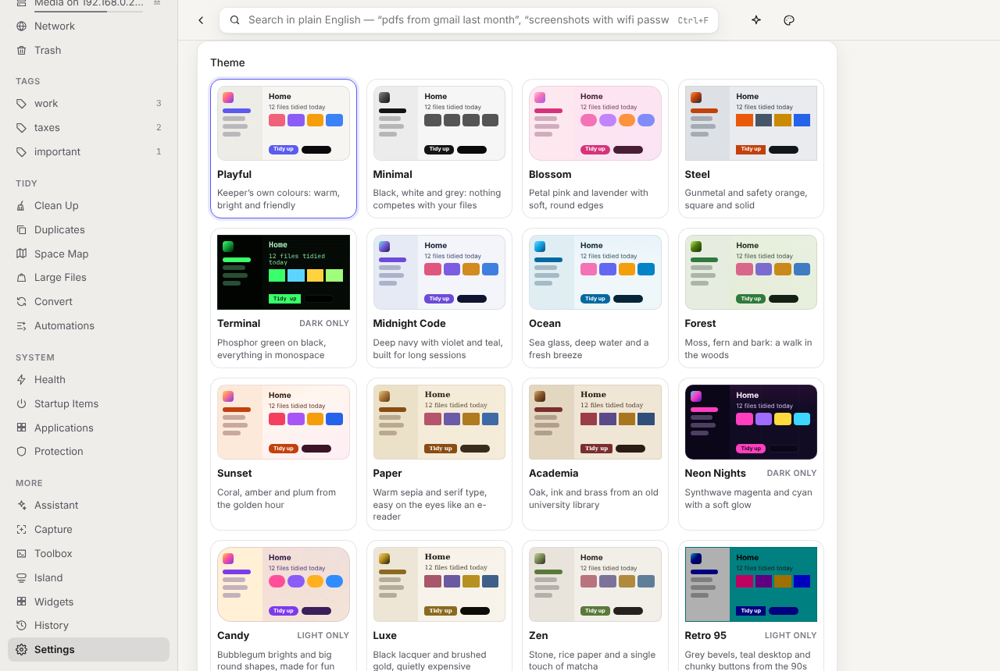 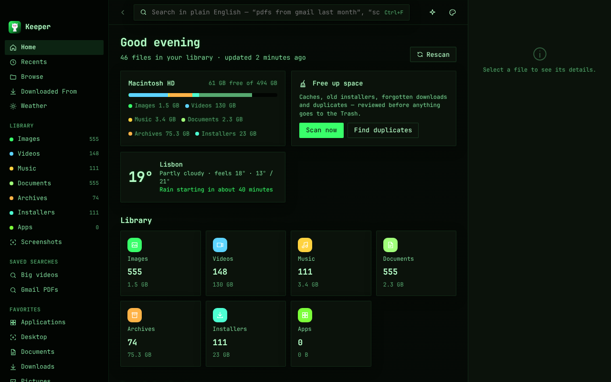</p>
<p>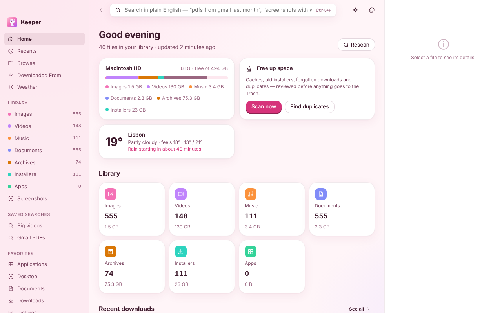 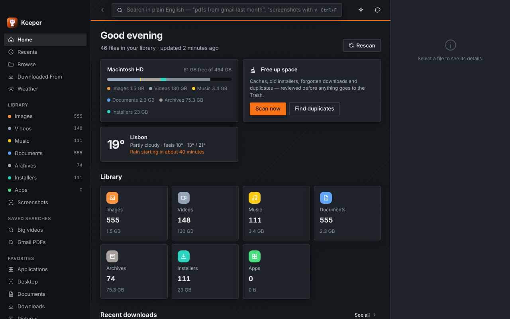</p>

### Quick Search, tray and deep links

- **Quick Search** (<kbd>Ctrl/⌘ Shift Space</kbd>, changeable): recent files when empty, live plain-English results; <kbd>↩</kbd> opens, <kbd>Ctrl/⌘ ↩</kbd> shows in Keeper, <kbd>Alt ↩</kbd> shows in the folder.
- **Command palette** (<kbd>Ctrl/⌘ K</kbd>) for every page and action.
- **Tray / menu bar**: the newest downloads (drag or click), Quick Search, copy text from screen, keep awake, Clean Up. Keeper keeps running in the tray so shortcuts, the Island and rules keep working.
- **`keeper://` links** for scripts, launchers and shortcuts: `keeper://search?q=…`, `keeper://ask?q=…`, `keeper://open?path=…`, `keeper://reveal?path=…`, `keeper://capture`, `keeper://quick`, `keeper://clean`, `keeper://awake?minutes=60`.

### Works with your computer

Keeper uses what your operating system already offers, each part switchable in **Settings → Works with your computer** ([details](docs/PLATFORM.md)):

- **Any AI app** that speaks MCP (Model Context Protocol) can search and read your library, with Keeper's safety rules. **Copy setup** gives a ready-made entry.
- **Ask Keeper from anywhere**: <kbd>Ctrl/⌘ Shift K</kbd> opens Quick Search ready for a question; `keeper://ask?q=…` does the same from scripts and shortcuts.
- **macOS**: **Apple Intelligence** as the assistant's model (on-device, no key; macOS 26 on Apple silicon), **Live Text** for text in images, Keeper's knowledge in **Spotlight**, and step-by-step **Shortcuts / Siri** and Services setups.
- **Windows**: Windows' own **text recognition**, **“Search with Keeper”** in File Explorer, a taskbar menu, and registration with the **on-device agent registry** where Windows has it.
- **Linux**: Keeper's results in **GNOME's Activities search** and **KDE's KRunner**, and launcher actions.

Honest limits: Siri phrases and Shortcuts actions of their own need an Xcode-built app (Keeper offers links and the `keeper` command instead); Windows' local AI model is only offered to Store-packaged apps.

### Toolbox

Small tools, all offline: copy text from screen (with QR), colour picker, dead-pixel test, keyboard-cleaning lock, link cleaner, **hide personal info before pasting into AI tools**, case converter, word counter, hidden-character inspector, password and passphrase generator, JSON formatter (with exact error position), Base64, SHA hashes, UUID v4/v7, JWT decoder, timestamp converter, regex tester, Wi-Fi sharing code, saved Wi-Fi passwords, and eject all drives.

### System

- **Health**: CPU, memory, uptime and load; battery level, health and cycle count; the busiest processes (with Quit); **what is keeping the computer awake**; and **local servers listening on a port** (open in the browser or stop).
- **Startup Items**: apps that start with the computer, with a rough impact rating; switch them off with the same setting the OS uses (reversible; system-wide items ask for permission).
- **Applications**: every installed app with size, version and last use; filter unused or large ones; uninstall via the app's own uninstaller (Windows), the Trash plus leftover support files (macOS) or Flatpak/Snap (Linux).
- **Protection**: a score for the security already built into your system — Gatekeeper, XProtect, SIP, FileVault, firewall and updates on macOS; Defender, real-time protection, definitions, firewall, UAC, SmartScreen, device encryption and Windows Update on Windows; firewall, disk encryption, Secure Boot, AppArmor/SELinux and automatic updates on Linux — with how to fix what is off. Keeper is not an antivirus.

### Assistant

Ask *“what can I safely delete?”* or *“why is my disk full?”*. The assistant sees **only file names, folders, sizes, dates and kinds — never contents** — and can only suggest: you pick what goes to the Trash. Use **Claude** or **OpenAI** with your own key (stored in your system keychain), or a **local model through Ollama** so nothing leaves your computer at all. Suggested paths are checked against what Keeper actually showed the model.

### Command line

The same engine runs in a terminal — handy for servers, scripts and Linux machines without a desktop. Read-only unless you pass `--yes`.

```bash
npm run build:cli
node dist-cli/keeper.cjs search "pdfs from gmail over 5 MB"
```

```text
keeper search <words>      Plain-English search
keeper scan                What can be freed: caches, installers, forgotten downloads, big files
keeper clean [group…]      Clear rebuildable caches (preview unless --yes)
keeper dupes               Exact duplicates and HEIC/JPEG pairs (--trash --yes to remove extras)
keeper stats               Files per shelf and where downloads came from (--sources)
keeper rules               Preview the automatic tidy-up rules
keeper agents              Status of Claude Code / Codex sessions on this computer

--in <folders>  --json  --limit <n>  --hidden  --yes
```

---

## Keyboard shortcuts

<kbd>Ctrl</kbd> on Windows and Linux is <kbd>⌘</kbd> on macOS.

| Find | | View | | Tidy and play | |
|---|---|---|---|---|---|
| Quick Search (any app) | <kbd>Ctrl Shift Space</kbd> | Grid / List | <kbd>Ctrl 1</kbd> / <kbd>Ctrl 2</kbd> | Duplicates | <kbd>Ctrl Shift D</kbd> |
| Search | <kbd>Ctrl F</kbd> | Bigger / smaller cards | <kbd>Ctrl +</kbd> / <kbd>Ctrl −</kbd> | Clean Up | <kbd>Ctrl Shift K</kbd> |
| Command palette | <kbd>Ctrl K</kbd> | Inspector | <kbd>Ctrl I</kbd> | Play / pause | <kbd>Ctrl Space</kbd> |
| Downloaded From | <kbd>Ctrl Shift J</kbd> | Preview | <kbd>Space</kbd> | Move to Trash | <kbd>Ctrl ⌫</kbd> / <kbd>Delete</kbd> |
| Copy text in selected images | <kbd>Ctrl Shift C</kbd> | Switch theme | <kbd>Ctrl Shift T</kbd> | Back | <kbd>Ctrl [</kbd> |
| Copy text from screen (any app) | <kbd>Ctrl Shift 2</kbd> | Settings | <kbd>Ctrl ,</kbd> | Dictation (any app) | <kbd>Ctrl Shift ;</kbd> |
| | | Show / hide hidden files | <kbd>Ctrl Shift .</kbd> | | |

Global shortcuts can be changed in Settings and Island settings.

---

## Keeper compared with your system file manager

Keeper works **alongside** Finder, File Explorer, Files or Dolphin — “Show in folder” is always one click away.

| | Finder / Explorer / Files | Keeper |
|---|:---:|:---:|
| Files grouped by kind as big thumbnails | partly | ✅ |
| Search by describing a file in plain English, with editable filters | — | ✅ |
| Search the text inside screenshots and photos | macOS only, limited | ✅ every OS |
| Copy text from any area of the screen, read QR codes | — | ✅ |
| See which site or app every download came from | — | ✅ |
| Duplicate and look-alike photo finder | — | ✅ |
| Safe cleanup of caches, installers, build folders and old downloads | — | ✅ |
| Space Map of what uses your disk | — | ✅ |
| Rules that tidy folders automatically, with undo history | — | ✅ |
| Batch rename with preview and undo | partly | ✅ |
| Tags on any OS | macOS only | ✅ |
| Favorites, cloud drives, disks with eject, network servers and Trash with Put Back in one sidebar | ✅ | ✅ same on every OS |
| Recent downloads in the tray, Quick Search over any app | — | ✅ |
| Clipboard history, shelf, focus timer, keep-awake | — | ✅ |
| Startup items, installed apps, security check, system health | separate tools | ✅ |
| Same app on Windows, macOS and Linux, plus a CLI | — | ✅ |

---

## Privacy

- **Your files never leave your computer.** Indexing, search, text recognition, duplicate detection and cleanup all run locally.
- **No account, no analytics, no telemetry.**
- Network requests Keeper makes, and only when the feature is on:
  - **Text-recognition language data** — downloaded once per language from the Tesseract data mirror, then cached. Images are never sent.
  - **Weather** — your chosen place's coordinates to [Open-Meteo](https://open-meteo.com) (no key, no account).
  - **Lyrics** — the song title, artist and length to [LRCLIB](https://lrclib.net).
  - **Calendar** — the `.ics` link you entered.
  - **Assistant** — file names, folders, sizes and dates (never contents) to the provider you chose; nothing at all with a local model.
  - **Dictation** — your recorded audio to the speech-to-text address you configured.
  - **Update check** — once a day, the latest release number from GitHub (can be turned off).
- API keys are encrypted with the operating system's keychain (Electron `safeStorage`). On Linux without a keyring, Keeper refuses to store keys rather than store them weakly.
- Passwords and secret keys you copy are not kept in clipboard history.

## Safety model

Cleaning tools should never cost you a file. Keeper's rules:

1. **Your files go to the Trash; caches are deleted.** Anything you made or downloaded — duplicates, old downloads, screenshots, installers, apps — goes to the system Trash/Recycle Bin. Caches, logs and temporary files rebuild themselves, so moving them to the Trash would free nothing; they are deleted.
2. **Only known places.** What to clean is derived from a known category, never from a path the interface sends; paths are resolved to their real form and checked again right before anything is touched. Cleanup only accepts files Keeper itself listed in the latest scan.
3. **System folders are off limits.** Drive roots, your home folder, Desktop/Documents/Downloads themselves, system folders, network paths, symbolic links and junctions, Windows 8.3 short names and trailing-dot tricks are refused; so is anything in a folder you excluded.
4. **Files in use are skipped.** Temp files touched in the last day and locked files are left alone and reported.
5. **Everything is reversible where possible.** Startup items are switched off the way the OS does it; rules are off until you enable them and can be previewed; History lists every change, and moves and renames can be undone.
6. **iCloud and OneDrive placeholders are skipped**, so a scan never triggers downloads.

---

## Install

```bash
# macOS and Linux
curl -fsSL https://raw.githubusercontent.com/ashfordeOU/keeper/main/scripts/install.sh | sh
```

```powershell
# Windows (PowerShell)
irm https://raw.githubusercontent.com/ashfordeOU/keeper/main/scripts/install.ps1 | iex
```

The scripts check every download against the release checksums and add the `keeper` command. Homebrew, winget, Scoop, Chocolatey, the AUR, Flatpak, Snap, apt and dnf repositories, npm (`keeper-cli`), uninstalling and verifying downloads are all covered in **[docs/INSTALL.md](docs/INSTALL.md)**.

Or download the latest build from **[Releases](https://github.com/ashfordeOU/keeper/releases/latest)**. The file names never change, so these links always give you the newest version:

| System | Download | Notes |
|---|---|---|
| **macOS 12+** — Apple silicon (M1–M4) | [Keeper-mac-arm64.dmg](https://github.com/ashfordeOU/keeper/releases/latest/download/Keeper-mac-arm64.dmg) | Open, drag Keeper into Applications |
| **macOS 12+** — Intel | [Keeper-mac-x64.dmg](https://github.com/ashfordeOU/keeper/releases/latest/download/Keeper-mac-x64.dmg) | |
| **Windows 10/11** (also runs on Windows on ARM) | [Keeper-setup-x64.exe](https://github.com/ashfordeOU/keeper/releases/latest/download/Keeper-setup-x64.exe) | Installer, per user, no admin needed |
| Windows, no install | [Keeper-portable.exe](https://github.com/ashfordeOU/keeper/releases/latest/download/Keeper-portable.exe) | Runs from anywhere, e.g. a USB stick |
| **Linux** x64 — any distribution | [Keeper-linux-x86_64.AppImage](https://github.com/ashfordeOU/keeper/releases/latest/download/Keeper-linux-x86_64.AppImage) | `chmod +x` and run |
| Linux ARM64 | [Keeper-linux-arm64.AppImage](https://github.com/ashfordeOU/keeper/releases/latest/download/Keeper-linux-arm64.AppImage) | |
| Debian, Ubuntu, Mint, Pop!_OS | `Keeper-linux-amd64.deb` / `-arm64.deb` | `sudo apt install ./Keeper-linux-amd64.deb` |
| Fedora, RHEL, openSUSE | `Keeper-linux-x86_64.rpm` / `-aarch64.rpm` | `sudo dnf install ./Keeper-linux-x86_64.rpm` |
| Other Linux | `Keeper-linux-x64.tar.gz` | Unpack anywhere and run `keeper` |

Every release also lists `SHA256SUMS.txt`, a Sigstore signature of it and GitHub build attestations; see [Verifying a download](docs/INSTALL.md#verifying-a-download).

### Updates

Keeper keeps itself up to date from these releases. In **Settings → Updates** you choose:

- **Install updates automatically** (default) — new versions download in the background and install the next time Keeper quits; a banner offers “Restart and update” sooner.
- **Ask before installing** — Keeper tells you a new version is out (banner, notification and tray menu), shows what changed, and waits for you.
- **Only when I check** — Keeper never looks on its own; press **Check now** whenever you like.

You can also opt in to **beta versions**. After an update, **What’s new** shows the release notes once.

| How Keeper was installed | How it updates |
|---|---|
| Windows installer, Linux AppImage | Replaces itself in place |
| macOS dmg | Downloads the new version, swaps the app in Applications and reopens (the old copy goes to the Trash) |
| Linux .deb / .rpm | Downloads the new package and installs it with your system’s password prompt |
| Windows portable, .tar.gz | Tells you and opens the download |

### First launch

Builds are not yet signed with paid Apple / Microsoft certificates:

- **Windows** — if SmartScreen appears, choose **More info → Run anyway**.
- **macOS** — drag Keeper to Applications, then run once: `xattr -cr /Applications/Keeper.app`.
- **Linux** — `chmod +x Keeper-*.AppImage`. For now playing, dictation and download sources install `playerctl`, `xdotool` (or `wtype` on Wayland) and `attr`.

### Permissions Keeper may ask for

| Permission | Why |
|---|---|
| Desktop, Documents, Downloads (macOS) | To show and search your files |
| Screen Recording (macOS) | Only for *Copy text from screen* |
| Accessibility / Automation (macOS) | To paste dictated text and read what Music or Spotify is playing |
| Microphone | Only while dictating |
| Administrator | Only when you switch a system-wide startup item or clean files that need it |

---

## Build from source

Requires **Node.js 22+**.

```bash
npm install          # dependencies and the Electron binary
npm run dev          # the app with hot reload
npm run demo         # the interface alone in a browser at http://localhost:5180, with sample data (your disk is not touched)
npm test             # unit tests for the search parser, duplicates, cleanup, rules, Island logic and more
npm run typecheck
npm run build        # interface + main process + CLI into dist/, dist-electron/, dist-cli/
npm run dist:win     # Windows installers (also :mac on a Mac, :linux on Linux)
```

Builds land in `release/`. Pushing a tag like `v0.2.0` runs the **Release** workflow, which builds every platform and attaches the installers to a GitHub Release.

## Project layout

```text
core/                 the engine — plain TypeScript, no Electron, shared by the app and the CLI
  query/              plain-English search: parser → chips → matching and ranking
  cleanup/            what can be cleaned on each OS, measuring and cleaning safely
  indexer.ts          the file library index (saved to disk, incremental)
  duplicates.ts       SHA-256 duplicates, perceptual look-alikes, format pairs, which copy to keep
  safety.ts           the rules every destructive action passes through
  rules.ts            automations; journal.ts history and undo; rename.ts batch rename
  island.ts           calendar (.ics), lyrics (.lrc), agent status, clipboard history, focus timer
  sources.ts          download-source detection; textools.ts toolbox helpers; weather.ts forecasts
  ai.ts               the metadata-only assistant (Claude, OpenAI, Ollama)
  api.ts              the typed contract between the interface and the main process
electron/             main process: windows, tray, shortcuts, IPC
  services/           files, OCR, screen capture, island, media, system, startup, apps, protection
cli/keeper.ts         the `keeper` command
src/                  React interface (screens, components, the Island window, Quick Search)
  mock.ts             sample data for `npm run demo`
test/                 Vitest unit tests
docs/                 screenshots and longer documentation
```

More detail in [docs/ARCHITECTURE.md](docs/ARCHITECTURE.md).

---

## Platform support

| Feature | Windows | macOS | Linux |
|---|:---:|:---:|:---:|
| Library, search, text in images, duplicates, cleanup, Space Map, rules, history | ✅ | ✅ | ✅ |
| Download sources | ✅ | ✅ | ✅ (browsers that write `user.xdg.origin.url`) |
| OS thumbnails (HEIC, PDF, video) | ✅ | ✅ | images |
| Copy text from screen | ✅ | ✅ | ✅ (X11; Wayland via portal) |
| Startup items | Registry + Startup folder | Launch agents, login items | XDG autostart |
| App uninstall | App's uninstaller | Trash + leftovers | Flatpak / Snap |
| Protection check | ✅ | ✅ | ✅ |
| Now playing + lyrics | System media session | Music, Spotify | MPRIS (`playerctl`) |
| Microphone-in-use | ✅ | — | ✅ |
| Dictation typing | ✅ | ✅ | X11 `xdotool` / Wayland `wtype` |
| Battery health & cycles | level | ✅ | ✅ |
| Tags | Keeper tags | Keeper tags | Keeper tags |

## Roadmap

Planned, roughly in order:

- Media and document converters in the file browser: compress a video to a target size, convert/resize/strip metadata from images, merge/split/compress PDFs, background removal — each output to a new folder, never overwriting.
- Multiple named shelves, instant drop actions and shareable upload links to your own storage.
- Weather tile charts (hourly rain, UV, wind) and trip forecasts from calendar events.
- Reading and writing macOS Finder tags; PDF text indexing.
- Screen recording and screenshot annotation.
- Signed and notarized builds; automatic updates; translations.
- Mirroring other apps' notifications, replacing volume/brightness overlays and controlling external monitor brightness (needs native helpers per OS).

Ideas and pull requests are welcome — see below.

## Contributing

Contributions of every size are welcome. Please read [CONTRIBUTING.md](CONTRIBUTING.md) — in short: keep the core free of Electron, add tests for engine changes, follow the safety model, and keep the interface copy plain and friendly. Security issues: see [SECURITY.md](SECURITY.md). Changes are listed in [CHANGELOG.md](CHANGELOG.md).

## License

Keeper is free software: you can redistribute it and/or modify it under the terms of the **GNU Affero General Public License** as published by the Free Software Foundation, either **version 3** of the License, or (at your option) any later version. See [LICENSE](LICENSE).

Copyright © 2026 Keeper contributors.

Keeper uses [Electron](https://www.electronjs.org), [React](https://react.dev), [Tesseract.js](https://tesseract.projectnaptha.com) (Apache-2.0), [jsQR](https://github.com/cozmo/jsQR) (Apache-2.0) and the [Anthropic TypeScript SDK](https://github.com/anthropics/anthropic-sdk-typescript) (MIT); forecasts by [Open-Meteo](https://open-meteo.com) (CC BY 4.0) and lyrics by [LRCLIB](https://lrclib.net).

---

<p align="center"><sub><b>Keeper by Ashforde®</b> · © 2026 Ashforde OÜ · Ashforde® is a registered trademark of Ashforde OÜ.<br>The code is free software under the GNU AGPL v3 or later; the Keeper and Ashforde names and logos identify official builds.</sub></p>
