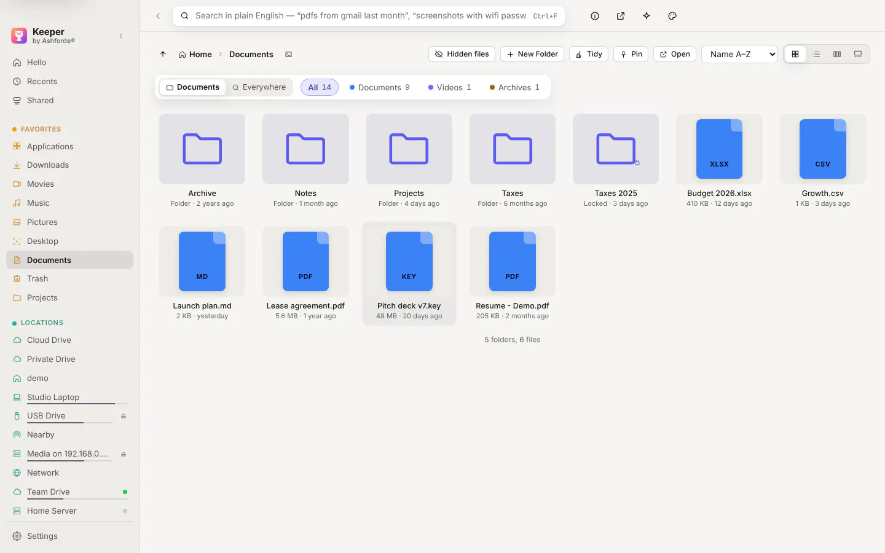
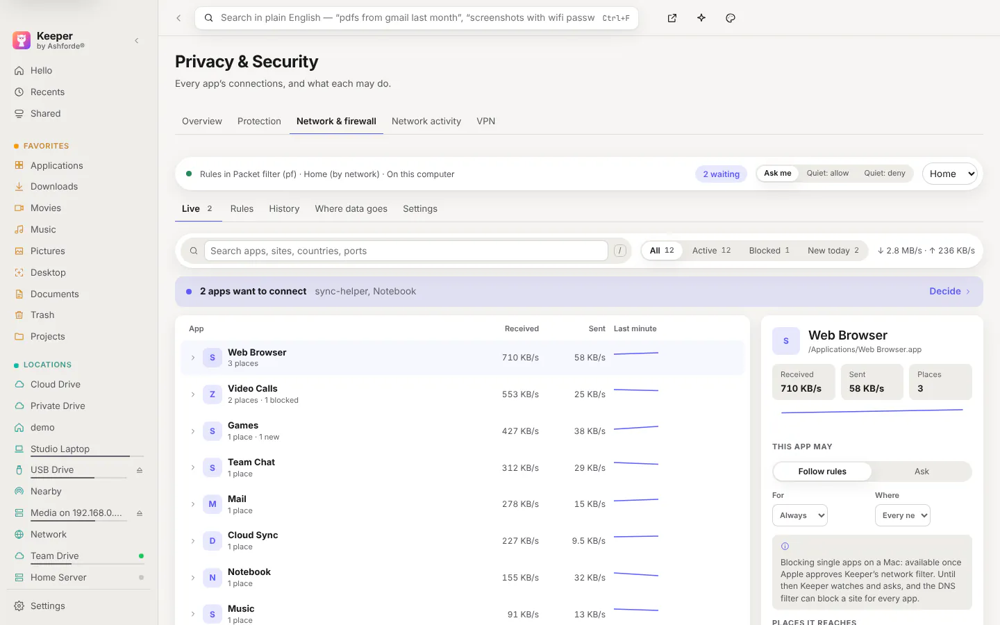
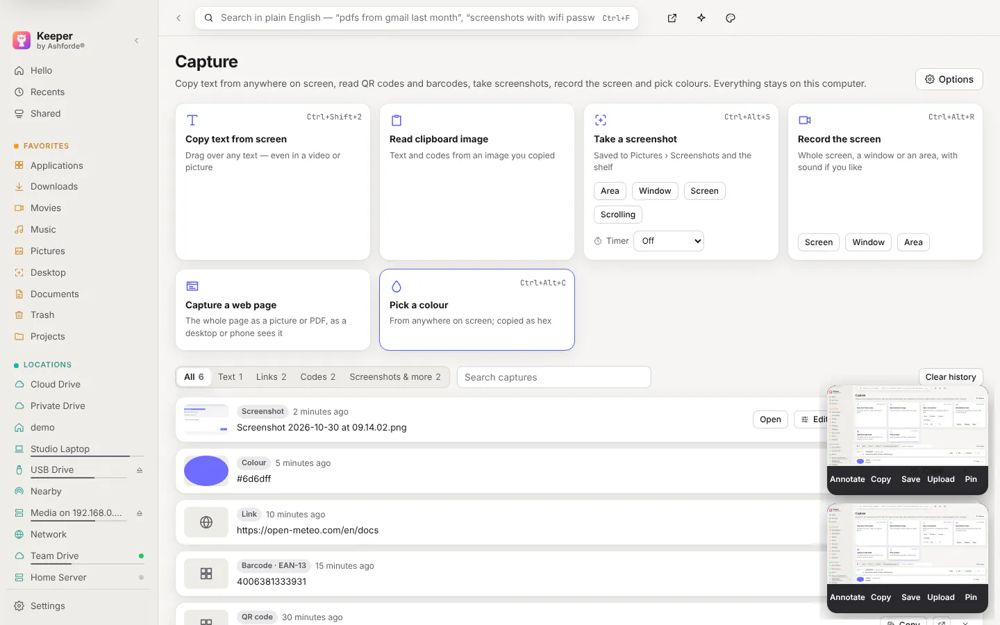
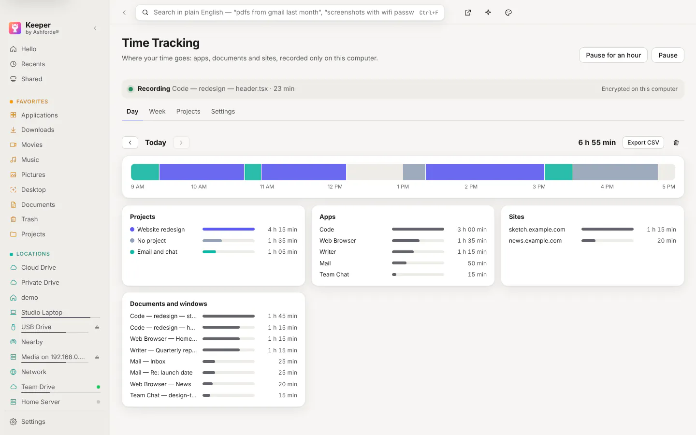
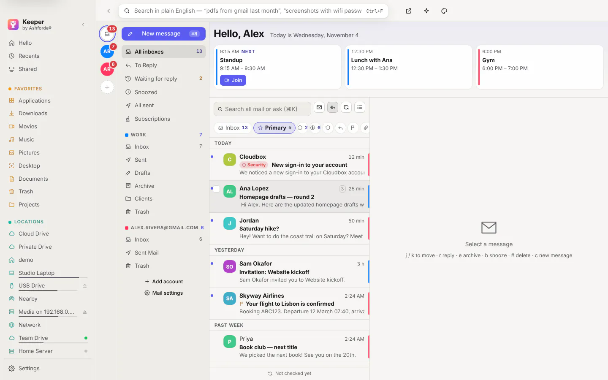
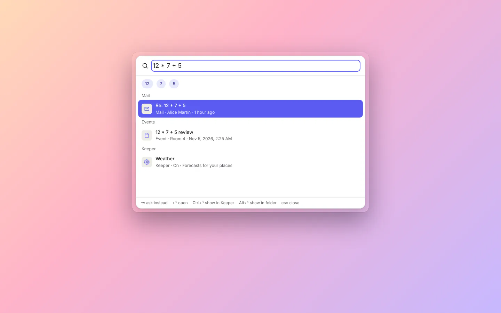

<p align="center">
  <picture>
    <source media="(prefers-color-scheme: dark)" srcset="docs/screenshots/home-dark.webp">
    
  </picture>
</p>

<h1 align="center">Keeper <sub><sup>by Ashforde®</sup></sub></h1>

<p align="center">
  <strong>One install, a whole suite for your computer, and your files stay on it.</strong><br>
  Files, Mail & Calendar, Notes, the Island, widgets, Studio and more, for <b>macOS, Windows and Linux</b>. Switch on only the parts you want.<br>
  <a href="https://keeper.ashforde.org"><b>keeper.ashforde.org</b></a>
</p>

<p align="center">
  <a href="https://github.com/ashfordeOU/keeper/releases/latest"></a>
  <a href="https://github.com/ashfordeOU/keeper/actions/workflows/ci.yml"></a>
  
  <a href="LICENSE.md"></a>
  
</p>

<p align="center">
  <a href="https://keeper.ashforde.org">Website</a> ·
  <a href="#what-keeper-is">What Keeper is</a> ·
  <a href="#highlights">Highlights</a> ·
  <a href="#screenshots">Screenshots</a> ·
  <a href="#install">Install</a> ·
  <a href="#requirements">Requirements</a> ·
  <a href="#updates">Updates</a> ·
  <a href="#privacy-and-security">Privacy and security</a> ·
  <a href="#documentation">Docs</a> ·
  <a href="#building-from-source">Building</a> ·
  <a href="#contributing">Contributing</a> ·
  <a href="#also-from-ashforde">Also from Ashforde</a> ·
  <a href="#licence">Licence</a>
</p>

---

## What Keeper is

Keeper is one app you install once. It is made of parts you switch on and off in **Settings → Features**, in the same groups and order as the app's sidebar:

| Part | What it does |
|---|---|
| **Files** | Home with your folders up front, a sidebar laid out like Finder, File Explorer or GNOME Files, type chips (Documents, Pictures…) in any folder or Everywhere, and search by name, kind, date or the words inside documents and pictures; disks, cloud drives, servers and locked folders ([docs/FILES.md](docs/FILES.md)) |
| **Mail & Calendar** | Mail, Calendar, Reminders, the Planner and the Clock with alarms, timers and world clocks; Today at the top of Hello and Plan my day, which puts three tasks into the free time between your events ([docs/TODAY.md](docs/TODAY.md)) |
| **Notes** | Markdown notes in folders you own, an Inbox that catches a thought, a link or a screenshot with one shortcut from any app, Cues that pop up in the right app or website, and Notes from Other Apps in one search |
| **Tidy** | Clean Up, Duplicates, the Space Map, Large Files, Convert, Automations and Undo History |
| **Sync & Backup** | Synced Folders, Backups, Cloud Mirrors and Older Versions |
| **Computer** | Health, Startup & Apps, System Controls, Keep Awake, Monitors for your sites and servers, and the Fix-it List |
| **Privacy & Security** | A score with fixes, checks of new downloads for malware, a firewall, network activity and VPNs |
| **Devices** | Your computers and phones, paired with a code: send files, share the clipboard, see and control another screen; Phone Alerts, Remote Desktops and Terminal |
| **AI** | The AI you choose, or one on this computer, for the Assistant, Agents, Dictation and Meetings, with what it may see and do set by you |
| **Screen** | Screenshots, whole web pages and text from the screen, a light photo editor, Studio for screen recordings, Stage for a clean screen, and the Toolbox |
| **Desktop** | Snap Windows, Buttons & Shortcuts, Widgets and folder boxes, Look & Feel (theme, wallpaper, sound and vibes), Weather, Places & Tracks, and Monorail on a Mac |
| **Island** | A live bar at the top of the screen: now playing, timers, the next meeting, new mail and a drop shelf |

**Each part runs on its own.** The Island, the widgets and Mail keep working if the main window stops, and a part that is off does not run at all ([docs/SUITE.md](docs/SUITE.md)).

**The download stays small.** Heavy pieces that only some parts use (video tools, on-device AI and cloud connections) download when you turn those parts on. The offline installer has everything inside ([docs/COMPONENTS.md](docs/COMPONENTS.md)).

## Highlights

- **Your files stay on your computer.** No account and no ads. [Privacy and security](#privacy-and-security) says what can go online.
- **Nothing is lost.** Files go to the Trash, every change is in Undo History, and moves and renames can be undone.
- **Mail that keeps up.** Important and Other inboxes, Send later, Snooze, Follow up, one-click Unsubscribe, rules and warnings about fake senders. Accounts connect with an app password; one-click sign-in with Google and Microsoft is not available yet.
- **Any page in its own window.** Open Mail, Calendar or any other page in a window of its own, and keep Keeper Mail, Keeper Calendar and Keeper Notes in your Dock, Start menu or app menu ([docs/WINDOWS.md](docs/WINDOWS.md)).
- **One search for everything.** Files, mail, events, tasks, contacts, notes, settings and Keeper's own pages from one box.
- **Folders like Finder and File Explorer.** Icons, list, columns or gallery; copy, cut, paste and drag, with Replace, Keep Both or Skip.
- **Studio.** Automatic zooms where you click, captions made on this computer, and export to MP4, WebM or GIF up to 4K.
- **The Island.** Sizes from Compact to Extra large, your calendars, and new important mail with Archive and Mark read.
- **Calm by design.** One bell for every notice, shown now, batched or kept silent per part, with quiet hours ([docs/NOTIFICATIONS.md](docs/NOTIFICATIONS.md)); one list of what is worth fixing, in calm words ([docs/GUIDE.md](docs/GUIDE.md)); and a **?** on every page with its guide, offline ([docs/HELP.md](docs/HELP.md)).
- **Help when something is wrong.** Check Keeper finds what is amber and fixes it; a problem report leaves out names, folders and keys, and nothing is sent ([docs/CHECK-KEEPER.md](docs/CHECK-KEEPER.md)).
- **Plain settings.** Two panes, search that understands everyday words, and a Reset button on every setting you changed.
- **The same everywhere.** macOS, Windows and Linux, plus the `keeper` command for terminals. Where a system can't do something, Keeper says so.

## Screenshots

<p>
  <picture>
    <source media="(prefers-color-scheme: dark)" srcset="docs/screenshots/home-dark.webp">
    
  </picture>
  <picture>
    <source media="(prefers-color-scheme: dark)" srcset="docs/screenshots/files-dark.webp">
    
  </picture>
</p>
<p>
  <picture>
    <source media="(prefers-color-scheme: dark)" srcset="docs/screenshots/network-dark.webp">
    
  </picture>
  <picture>
    <source media="(prefers-color-scheme: dark)" srcset="docs/screenshots/capture-preview-dark.webp">
    
  </picture>
</p>
<p>
  <picture>
    <source media="(prefers-color-scheme: dark)" srcset="docs/screenshots/time-dark.webp">
    
  </picture>
  <picture>
    <source media="(prefers-color-scheme: dark)" srcset="docs/screenshots/mail-dark.webp">
    
  </picture>
</p>
<p>
  <picture>
    <source media="(prefers-color-scheme: dark)" srcset="docs/screenshots/notes-dark.webp">
    
  </picture>
  <picture>
    <source media="(prefers-color-scheme: dark)" srcset="docs/screenshots/launcher-dark.webp">
    
  </picture>
</p>

Everything in 1.0 is listed in the [changelog](CHANGELOG.md).

---

## Install

Every download is on the **[Releases](https://github.com/ashfordeOU/keeper/releases)** page. A version can come out for macOS first, so pick the newest release that lists your system's file. The install scripts do this for you.

### macOS

```bash
curl -fsSL https://raw.githubusercontent.com/ashfordeOU/keeper/main/scripts/install.sh | sh
```

The script picks the right disk image for your Mac (Apple silicon or Intel), checks it against the release's `SHA256SUMS.txt`, puts Keeper in Applications and opens it. Or:

- **The disk image.** `Keeper-mac-arm64.dmg` (Apple silicon) or `Keeper-mac-x64.dmg` (Intel) from [Releases](https://github.com/ashfordeOU/keeper/releases); drag Keeper into Applications.
- **The offline installer.** `Keeper-mac-arm64-full.dmg` or `Keeper-mac-x64-full.dmg` has every part inside, for computers without a network. With the script, add `-s -- --full` after `sh`.
- **Homebrew.** Add the tap, then install the app.

  ```bash
  brew tap ashfordeOU/keeper https://github.com/ashfordeOU/keeper
  brew install --cask keeper
  ```

Keeper for macOS is **signed and notarised by Apple**. It opens like any other app.

Keeper asks for system permissions only for the parts that need them. [docs/PERMISSIONS.md](docs/PERMISSIONS.md) says what each one is for.

### Windows

```powershell
irm https://raw.githubusercontent.com/ashfordeOU/keeper/main/scripts/install.ps1 | iex
```

Or run `winget install Ashforde.Keeper`, or download `Keeper-setup-x64.exe` from [Releases](https://github.com/ashfordeOU/keeper/releases). It installs for your user only, so no administrator is needed; `Keeper-setup-x64-full.exe` is the offline installer. Keeper for Windows is not signed with a paid certificate, so if SmartScreen appears, choose **More info → Run anyway**.

### Linux

```bash
curl -fsSL https://raw.githubusercontent.com/ashfordeOU/keeper/main/scripts/install.sh | sh
```

The script installs the `.deb` (Debian, Ubuntu), the `.rpm` (Fedora, openSUSE) or else the AppImage, on x64 and ARM64. The files are on [Releases](https://github.com/ashfordeOU/keeper/releases).

### Everything else

Scoop, Chocolatey, the AUR, Flatpak, Snap, the apt and dnf repositories, the `keeper` command on its own, uninstalling and verifying a download are in **[docs/INSTALL.md](docs/INSTALL.md)**.

## Requirements

- **macOS** 12 or later, on Apple silicon or Intel.
- **Windows** 10 or 11, 64-bit; Windows on ARM runs the x64 build.
- **Linux**, 64-bit, on x64 or ARM64. The AppImage needs FUSE 2. Now playing, dictation and download sources use `playerctl`, `xdotool` (or `wtype` on Wayland) and `attr`.

## Updates

Keeper updates itself. Choose how in **Settings → General → Updates**: **Install updates automatically**, **Ask before installing** or **Only when I check**. **Check for Updates…** shows what changed, with **Install and Relaunch**, **Later** and **Skip this version**.

Every update is checked before it is installed: it must match the release's `SHA256SUMS.txt`, and on a Mac it must be signed with Ashforde's Developer ID. Parts downloaded when you turn them on are checked the same way.


---

## Privacy and security

- **Your files are never uploaded.** Search, text in pictures, duplicates, cleanup, notes and dictation run on this computer.
- **Only the parts you turn on go online.** These are weather (from MET Norway), lyrics, site monitors and phone alerts you set up, the mail, calendars and cloud services you connect, the update check, and the AI you choose.
- **Your AI sees only what you allow.** Passwords, keys and card numbers are blanked out before text goes to an AI on the internet. **Only use AIs on this computer** in **Settings → AI** keeps everything here.
- **Anonymous usage stats are off until you tick the box** in setup. They go once a day, with no file names, searches or account names, and **See exactly what's sent** in **Settings → Privacy & permissions** shows each report ([docs/PRIVACY-USAGE-STATS.md](docs/PRIVACY-USAGE-STATS.md)).
- **Crash reports are off until you switch them on** in **Settings → Privacy & permissions**: anonymous, never the error's message, your folders or names, and **See what's sent** shows them ([docs/CRASH-REPORTS.md](docs/CRASH-REPORTS.md)).
- **Passwords and keys stay in your system's keychain.** That is Keychain on a Mac, Credential Manager on Windows, and Secret Service or KWallet on Linux.
- **Every release can be checked.** It lists `SHA256SUMS.txt`, a Sigstore signature of that file and GitHub build attestations ([Verifying a download](docs/INSTALL.md#verifying-a-download)).
- **Found a security problem?** Please report it privately, as [SECURITY.md](SECURITY.md) describes, not in a public issue.

---

## Documentation

| Area | Documents |
|---|---|
| Getting started | [Install](docs/INSTALL.md) · [Permissions](docs/PERMISSIONS.md) · [Themes](docs/THEMES.md) · [Accessibility](docs/ACCESSIBILITY.md) |
| The suite | [Keeper as a suite](docs/SUITE.md) · [Send to…](docs/SEND-TO.md) · [Automation](docs/AUTOMATION.md) · [Extensions](docs/EXTENSIONS.md) · [Pages in windows of their own](docs/WINDOWS.md) · [Parts downloaded when switched on](docs/COMPONENTS.md) · [Staying up after a crash](docs/RESILIENCE.md) · [Performance budgets](docs/PERFORMANCE.md) · [Works with your computer](docs/PLATFORM.md) |
| Files | [Cloud and servers](docs/CONNECT.md) · [PDF tools and Convert](docs/FILEKIT.md) |
| Mail & Calendar | [Mail, calendars, reminders and the clock](docs/PIM.md) · [Planner](docs/PLANNER.md) |
| Notes | [Notes](docs/NOTES.md) · [Notes from other apps](docs/NOTES-EVERYWHERE.md) |
| Sync & Backup | [Sync and backup](docs/SYNC.md) · [Moving and backing up Keeper itself](docs/KEEPER-BACKUP.md) |
| Computer | [System monitor](docs/MONITOR.md) · [Keep Awake](docs/KEEP-AWAKE.md) · [Quick Controls](docs/QUICK-CONTROLS.md) · [Hidden system settings](docs/SETTINGS-CATALOG.md) · [Fix-it List](docs/GUIDE.md) |
| Privacy & Security | [Privacy & Security](docs/SECURITY-CENTER.md) · [Firewall](docs/FIREWALL.md) · [Network activity and VPN](docs/NETWORK.md) · [Anonymous usage stats](docs/PRIVACY-USAGE-STATS.md) |
| Devices | [Keeper Link](docs/LINK.md) · [Remote screens and phones](docs/REMOTE.md) · [Remote Desktops](docs/REMOTE-DESKTOPS.md) · [Keeper Mesh](docs/MESH.md) · [Terminal](docs/TERMINAL.md) |
| AI | [Your files and AI](docs/BRAIN.md) · [Knowledge graph](docs/KNOWLEDGE-GRAPH.md) · [AI agents](docs/AGENTS.md) · [AI skills](docs/ABILITIES.md) · [Computer use](docs/COMPUTER-USE.md) · [AI usage](docs/USAGE-TRACKER.md) · [Dictation and meetings](docs/VOICE.md) |
| Screen | [Stage](docs/STAGE.md) · [Toolbox](docs/TOOLS.md) |
| Desktop | [Quick Search, typed snippets and selected text](docs/LAUNCHER.md) · [Look & Feel](docs/AMBIENCE.md) · [Places & Tracks](docs/TRACKS.md) · [Keeper and Monorail](docs/KEEPER-MONORAIL.md) |
| Island | [Island tools](docs/ISLAND-TOOLS.md) · [Island+ and Cues](docs/ISLAND-CUES.md) · [The Island's colours](docs/ISLAND-LOOK.md) |
| Project | [Changelog](CHANGELOG.md) · [How Keeper is built](docs/ARCHITECTURE.md) · [The visual budget](docs/DESIGN-BUDGET.md) · [Contributing](CONTRIBUTING.md) · [Security policy](SECURITY.md) · [Releasing](RELEASING.md) |

## Building from source

You need **Node.js 22.12 or later**.

```bash
npm install          # dependencies and the Electron binary
npm run dev          # the app, reloading as you edit
npm test             # unit tests
npm run dist:mac     # installers (dist:win and dist:linux on those systems)
```

The project layout is in [docs/ARCHITECTURE.md](docs/ARCHITECTURE.md), and how a release is made is in [RELEASING.md](RELEASING.md).

## Contributing

Contributions are welcome. Please read [CONTRIBUTING.md](CONTRIBUTING.md) and its [contributor terms](CONTRIBUTING.md#contributor-terms) before your first pull request.

## Also from Ashforde

**[Monorail](https://monorail.ashforde.org)** is Ashforde's scrolling window manager for macOS 13 and later. Your windows sit side by side on a strip you slide through, with workspaces and layouts. On a Mac, Keeper can install Monorail, keep it up to date and work with it: turn on **Monorail** in **Settings → Features**, and find the rest under **Other apps by Ashforde** on the same page. [Keeper and Monorail](https://monorail.ashforde.org/keeper/) shows what the two do together.

## Licence

Keeper is **free to use** for everyone, at home and at work. It is **source-available**, not open source, under the [PolyForm Shield License 1.0.0](LICENSE.md). You may:

- Use Keeper for any purpose, personal or professional.
- Read, build and change the code for yourself or your organisation.
- Build tools, scripts and integrations that work with Keeper.

You may not sell or offer Keeper, or a changed Keeper, as a product or service that competes with it without written permission from Ashforde OÜ ([COMMERCIAL.md](COMMERCIAL.md)).

“Keeper by Ashforde®”, “Ashforde®” and the Keeper logo are trademarks of Ashforde OÜ, and changed builds must use a different name and logo ([TRADEMARKS.md](TRADEMARKS.md)). For a commercial licence, write to **contact@ashforde.org**. Third-party components and their licences are in [THIRD-PARTY-NOTICES.md](THIRD-PARTY-NOTICES.md).

---

<p align="center">
  <br>
  <sub><b>Keeper by Ashforde®</b> · <a href="https://keeper.ashforde.org">keeper.ashforde.org</a> · © 2026 Ashforde OÜ · Ashforde® is a registered trademark of Ashforde OÜ.<br>Source-available under the PolyForm Shield License 1.0.0 and free to use.</sub>
</p>
